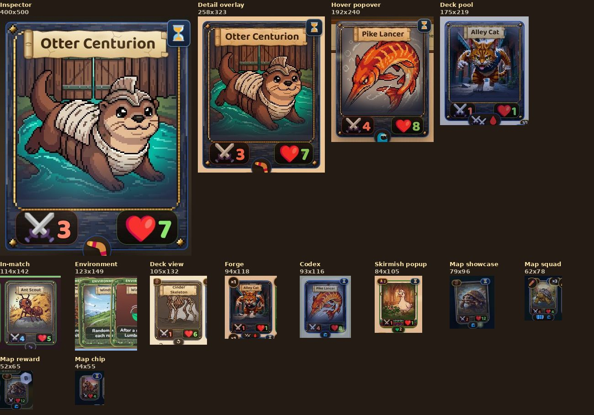
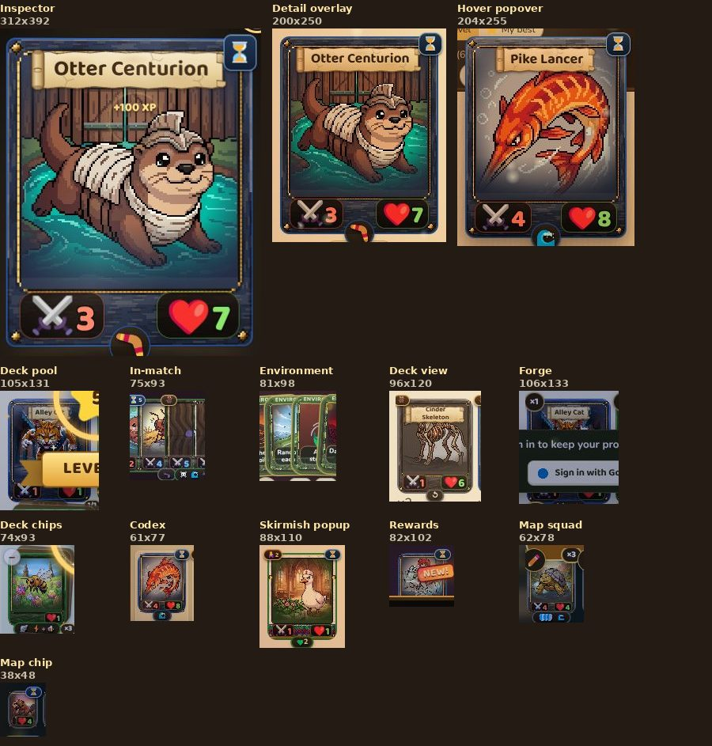

# Card sizes: audit and proposal (package CARDSIZE1, 2026-10-29)

Owner, 2026-10-29 19:14: "Currently we have like 10 sizes. Can we reduce to just 3 or 4? It's too much. One huge blown up one for detail, and 'tacit', you can spin it around etc."

This is an audit and a proposal. No game code changed. The mock page is `docs/design/card-sizes-2026-10-29.html`: open it locally, or publish it as a page (the two card images are inlined).

## Summary

- **The game draws cards at about 20 different sizes on the screens we measured, not 10.** The CSS has 132 rules that set a card tile's width, with 56 different values, and 42 definitions of the in-match size `--match-card-w/h`. About 25 more sizes exist only in CSS, for screens this audit did not open (Stomping Grounds, Arena, editor and admin tools, tutorial steps).
- **Proposal: four sizes, all drawn by `cardTileHTML(d, {size})`.**
  - **Detail** is one large card that can be tilted and spun, with its text beside it and lore and levels on the back.
  - **Full** is the standard card for every browsing screen.
  - **Compact** is the board card, sized by the board as it is today.
  - **Chip** is a small token with an art disc and the name, for lists and mentions.
- **Riskiest parts:** the battle board at 390 (GSAP Flip and the hand fan depend on the current sizes), the pack-opening flight, and the win screen's height-based fit.
- **Effort:** about 9 to 11 agent-days across 5 packages. In-match changes go last.

## 1. What exists today

Measured with `tools/cardsize1_shots.py` (Playwright, admin mode, maps unlocked, onboarding skipped). The script opens each screen at 1366×860 and 390×844 and measures every `.card-tile` and card-like element with `getBoundingClientRect`. Sizes are in CSS px. The raw data is in `tests/out/cardsize1-<w>.json` (not committed). Crops are in `docs/screens/cardsize1/`. Every crop is a real screenshot, so a few include an overlay or an animation frame. Where a crop is poor, the full-screen shot is linked instead.

True-scale sheets (each card at its real pixel size, side by side):
- 1366: 
- 390: 

Legend for "Shows": A art, N name (legible), S Attack and Health, C cost, W Wait, K skill icons, T skill text, F flavour, R rarity frame (every variant has R).

| # | Variant | Rendered by (CSS) | 1366 | 390 | Where | Shows | Crop | Proposed |
|---|---|---|---|---|---|---|---|---|
| 1 | Card Inspector (spin) | `openCardInspector` · `.ci-spin` `min((100vh-190px)*.8, 80vw, 400px)` | 400×500 | 312×392 | 🔍 Inspect in the detail, pack results | A N S W K, drag to turn, finish picker (admin) | [1366](../screens/cardsize1/inspector--ci-face-ci-spin-1366.jpg) · [390](../screens/cardsize1/inspector--ci-face-ci-spin-390.jpg) | **Detail** |
| 2 | Card Detail overlay | `openCardDetail` · `.card-detail-card` (820 / 100%) with a card visual | card 258×323 in an 820×870 panel | card 200×250 in a 358 panel | tap a card in the Codex and other screens | A N S W K + T F tags, admin tools | [1366](../screens/cardsize1/detail--card-pop-visual-cd-grid-1366.jpg) · [panel](../screens/cardsize1/detail-full-1366.jpg) · [390](../screens/cardsize1/detail-full-390.jpg) | **Detail** |
| 3 | Pack reveal | `openPackAnimation` · `.po2-front` | 360×450 | 312×390 | pack opening, one card at a time | A N S W K | [390](../screens/cardsize1/pack-card-full-390.jpg) · [1366](../screens/cardsize1/pack-card-full-1366.jpg) | **Detail** (no text panel) |
| 4 | Hover popover | `fullCardHTML` in `#cardPop` (264px panel, `.card-pop-visual-tile`) | card 192×240 in a 264 panel | card 204×255 in a 272 panel | hover or long-press anywhere, including the board | A N S W K + T | [1366](../screens/cardsize1/codex-hover--card-pop-visual-cardpop-1366.jpg) · [390 panel](../screens/cardsize1/codex-hover--hover-popover-cardpop-390.jpg) | **Full + text** (decision D1) |
| 5 | In-match card | `boardCardHTML` / hand strip / leader / HQ tiles, all `--match-card-w/h` | 114–131 × 142–164 (raid 73–80 × 91–99) | 49–75 × 61–93 | board, hand, leader, both Brambles, deck stacks | A N(desktop) S W K, live status | [board](../screens/cardsize1/fight--board-card-board-row-1366.jpg) · [hand](../screens/cardsize1/fight--hand-strip-bottom-play-row-1366.jpg) · [390](../screens/cardsize1/fight-full-390.jpg) · [raid](../screens/cardsize1/raid-fight-full-1366.jpg) | **Compact** |
| 6 | Environment / field cards | `envCardHTML`, `matchFieldTileHTML` · `.env-card` (fanned) | 117–142 × 144–173; raid 64–70 × 142–145 | 77–81 × 95–98; raid 52–55 × 65–67 | top row of a fight | A N + one rule line | [1366](../screens/cardsize1/fight--env-card-1366.jpg) · [raid](../screens/cardsize1/raid-fight--env-card-1366.jpg) | **Compact** |
| 7 | Deck builder: pool | `renderMyDeckPanels` · `.pool-grid .card-tile` (`width:100%`) | 175×219 | 105×131 | Camp › deck › the cards you own | A N S K | [1366](../screens/cardsize1/deck--pool-stack-pool-grid-1366.jpg) · [390](../screens/cardsize1/deck--pool-stack-pool-grid-390.jpg) | **Full** |
| 8 | Deck builder: loadout | `.dchip .card-tile` | 101×126 | 74×93 | Camp › deck › Your Loadout | A N S K | [full](../screens/cardsize1/deck-full-1366.jpg) · [390](../screens/cardsize1/deck--pool-stack-dchip-390.jpg) | **Full** |
| 9 | Deck builder: Bramble and leader | `.dt-tile` (120×150, 104×130, 96×120) | 96×120 | 96×120 | top of the deck builder | A N S | [390](../screens/cardsize1/deck--dt-tile-dt-slot-390.jpg) | **Full** |
| 10 | Deck picker popup (skirmish decks) | `openDeckBuilderPopup` · `.dbp-stack` | 84×105 | 88×110 | skirmish and test decks | A S C W K | [1366](../screens/cardsize1/deck-popup--pool-stack-dbp-stack-1366.jpg) · [390](../screens/cardsize1/deck-popup--pool-stack-dbp-stack-390.jpg) | **Full** |
| 11 | Codex album | `renderCodexGrid` · `.cx-tile-wrap` | 93×116 (name 8px) | 61×77 | Codex › Browse | A S W K (name too small to read) | [1366](../screens/cardsize1/codex--cx-tile-wrap-al-sleeve-1366.jpg) · [390](../screens/cardsize1/codex--cx-tile-wrap-al-sleeve-390.jpg) | **Full** |
| 12 | Forge pool | `.forge-tile` | 94×118 | 106×133 | Forge | A N S K | [1366](../screens/cardsize1/forge--forge-tile-pool-grid-1366.jpg) · [390](../screens/cardsize1/forge--forge-tile-pool-grid-390.jpg) | **Full** |
| 13 | Match deck view | `openMatchDeckView` · `.mdv-card` | 105×132 | 96×120 | a fight › a deck pile | A N S C K | [1366](../screens/cardsize1/fight-deckview--mdv-card-pool-grid-1366.jpg) · [390](../screens/cardsize1/fight-deckview--mdv-card-pool-grid-390.jpg) | **Full** |
| 14 | Profile showcase | `.ds-tile` (92×115) | 92×115 | – | Profile | A N S | [full](../screens/cardsize1/profile-full-1366.jpg) | **Full** |
| 15 | Win screen: cards won / seen | `.rw-card` (12 clamp rules, 54–170px by vh and vw) | about 125×155 when settled | 82×102 won · 62×78 seen | Victory panel | A S C W K | [390](../screens/cardsize1/rewards--rw-card-res3-g-390.jpg) · [full](../screens/cardsize1/rewards-full-390.jpg) | **Full** (won) · **Compact** (seen) |
| 16 | Pack summary | `.po2-front` in slots, `.po2-mini` | 65×81, minis 53×66 | 56×70, minis 42×53 | pack opening, last step | A S W K | [1366](../screens/cardsize1/pack-summary-full-1366.jpg) · [390](../screens/cardsize1/pack-summary-full-390.jpg) | **Full** (cards) · **Chip** (minis) |
| 17 | Map fight panel: leader showcase | `.cnp-showcase` | 79×96 | 79×96 | map › a fight's panel | A S C W K | [1366](../screens/cardsize1/map--cnp-showcase-cnp-head-1366.jpg) | **Compact** |
| 18 | Map fight panel: enemy squad | `.cnp-sq-card` | 62×78 | 62×78 | map › a fight's panel | A S C W K, ×copies | [1366](../screens/cardsize1/map--cnp-sq-card-cnp-sq-wrap-1366.jpg) · [390](../screens/cardsize1/map--cnp-sq-card-cnp-sq-wrap-390.jpg) | **Compact** |
| 19 | Map fight panel: first-clear reward | `.cnp-rw-card` (+ 150px `.cnp-rw-zoom` on hover) | 52×65 | 52×65 | map › a fight's panel | A S C W K | [1366](../screens/cardsize1/map--cnp-rw-card-cnp-rw-items-1366.jpg) | **Compact** (hover › Full) |
| 20 | Map card chips (VIS4, PACK1) | `vis4MapCardTilesHTML` · `.vis4-mc-card` | 44×55 | 38×48 | map panel "This map's cards", Map cards dialog | A S W (all text unreadable) | [1366](../screens/cardsize1/map--vis4-mc-card-vis4-mc-row-1366.jpg) · [390](../screens/cardsize1/map--vis4-mc-card-vis4-mc-row-390.jpg) | **Chip** |
| 21 | Map review tile (REVIEW1, admin) | `rv1TilesHTML` · `.rv1-tile` 92 wide (a 44×55 chip + caption) | 92×139–163 | 92×132–156 | Map cards dialog, admin review | chip + who/why caption + Cut button | [1366](../screens/cardsize1/map-cards--review-rv1-tile-1366.jpg) · [full](../screens/cardsize1/map-cards-full-1366.jpg) | **Chip** + caption |

Card-like elements outside `.card-tile` that the audit also met: graveyard peek `.gpk-mini` (art + name row), Bramble codex `.char-card`, trench `.tr-card`, castle `.ab-castle-tile`. All of these become **Chip** or **Full**.

Sizes found only in the CSS, for screens not opened here (each is a separate hard-coded width): hero card 150×188, Stomping Grounds plinth 168×210 and hp cards 120×150 / 84×105, entrance fan 168 and 184, raid reward flip 220×275, card decorator 180, card editor preview 150×196 / 110×144, Discover 78×108, Forge bulk 62×78, deck mini `.dm-card` 52, tutorial deal `.ss-card` 82, lumber lesson 96×120, first pick 70, deck-swap thumbs 36 / 46 / 72 / 86 / 112, group dungeon hand 84 / 100, Arena offers 150 / 104 and slots 130, faction showcase `min(9vw,112px)`, Codex full-art grid 168, admin grid `scale(.8)`, inventory `.fc-tile` `zoom:.62`. All of these map onto the same four sizes: big, one-at-a-time views become Detail; browsing grids become Full; dense previews become Compact; thumbnails become Chip.

Findings along the way:
- **Six separate 3D flip implementations**: `.ci-*` (Inspector), `.po-*`, `.po2-*` (packs), `.ef-*` (entrance fan), `.rr-*` (raid reward), `.pl1-fsf-*` (faction showcase), plus `.flip3d-*` (Forge anvil). Detail would replace them with one.
- **Names are unreadable on most browsing tiles.** The Codex tile's name renders at 8px at 1366 and is hidden at 390. The map chips and squad cards show no name.
- **The raid's top row is squeezed.** Its Bramble and environment tiles measure 64–70×142–145 at 1366 (aspect 0.45, not 0.8).
- **The in-match size varies between runs at the same width** (114 vs 131 px at 1366), because it follows the viewport height (`100dvh`). This is intended, but every test of the board must state its viewport height.
- **The same 1366 screen can hold four sizes at once.** Example: the map panel shows the leader at 79, the squad at 62, the reward at 52 and the chips at 44.

## 2. Proposal: four sizes

One renderer, `cardTileHTML(d, {size})`, adds `data-size="detail|full|compact"` to `.card-tile`. Each size is one CSS custom property. The tile is already a size container (`container-type:inline-size`, text in `cqw`), so the card's own container queries decide what fits. The calling screen chooses the size and never sets a pixel width. `cardChipHTML(d)` is the one separate renderer, because a chip is not a card.

| Size | Token | 1366 | 390 | Shows | Motion |
|---|---|---|---|---|---|
| **Detail** | `--card-detail-w: min(400px, 86vw, (100dvh - 190px) * .8)` | 400 | about 335 | everything: A N S C W K, skill names and text, flavour; the back has lore, the level table and where to get it | tilt with parallax on the art, drag to spin, tap or Enter to flip; reduced motion swaps faces with no rotation |
| **Full** | `--card-full-w: clamp(84px, 22vw, 120px)` | 120 | 86 | A N (2 lines, about 13px at 120) S C W K, rarity frame | hover tilt (`.card-tile-magnetic`) in browsing screens only, as the style guide says |
| **Compact** | in a match `--match-card-w` (fluid 49–131), elsewhere `--card-compact-w: 64px` | 64 / board | 64 / board | A S C W K; the name only when the card is 70px or wider (container query) | combat animation only (unchanged) |
| **Chip** | `--chip-h: 30px` | 30 tall | 30 tall | art disc with a rarity ring, name; optional ⚔/❤ | none; a tap opens Detail |

**Detail is the tactile card the owner asked for.** It merges the Card Inspector (the spin stage) with the Card Detail overlay (the text). On desktop the card sits left and the text right; on a phone the text sits below. The back face carries lore, the level table and where to get the card, instead of today's plain crest. The mock shows a working tilt, parallax, drag-to-spin and flip, and it respects `prefers-reduced-motion`.

### Where each current variant goes

| Current | Becomes | Loses | Gains |
|---|---|---|---|
| Inspector, Card Detail, pack reveal, raid reward flip, hero card, Stomping plinth, entrance fan, decorator / editor previews | **Detail** | the 820px two-column panel's fixed width (the text panel stays, at a fluid width); the separate admin finish picker moves under the card | one flip and tilt everywhere; the pack reveal can be spun; the back face has content |
| Codex, Forge, Nest, deck builder pool / loadout / top slots, deck picker popup, match deck view, profile showcase, cards won, pack summary cards, shop, Arena offers, Discover, tutorial picks | **Full** | the deck builder pool shrinks 175→120 at 1366 (more cards per row); Forge 106→86 at 390 | the Codex grows 93→120 at 1366 and 61→86 at 390, so names become readable; one grid size everywhere |
| Hover popover's card visual | **Full** + its text block (D1) | the larger 192–204px picture | the same look as the card you hovered |
| Board, hand, leader, HQ tiles, environment cards | **Compact** (`--match-card-w`, unchanged lever) | the 8px name on a phone board (hidden below 70px; tap for Detail) | the stats can use the space the name took |
| Map leader / squad / reward previews, "cards seen" on the win screen | **Compact** 64px | the leader showcase shrinks 79→64 | the three previews match each other |
| Map card chips (VIS4, PACK1), REVIEW1 tiles, pack summary minis, graveyard peek, deck mini, deck-swap thumbs, log mentions, drop lines | **Chip** | Attack / Health / Wait on the map chips (unreadable today; optional ⚔/❤ suffix) | a readable name; one token for logs and inline mentions |

### Risky spots

1. **Board fit at 390.** The board already shrinks to 49×61 with five units per lane. Compact keeps `--match-card-w` and its fluid formula, and adds only the container query that hides the name below 70px. The mock's phone board shows 5+5 units and a 4-card hand at 62px. The style guide forbids per-context board sizes, and this proposal keeps that rule.
2. **Lane layout and GSAP Flip.** Flip diffs element boxes, and the play animation reads board uids from the DOM. Do not restructure `boardCardHTML` (the style guide calls it "separate, on purpose"). Only add `data-size="compact"` to the inner tile. Move in-match last, in its own package with an owner playtest.
3. **Pack opening.** `.po2-front` flies from the 360px reveal into 65px summary slots, and the flight measures both boxes. When the reveal becomes Detail and the slots become Full, test the flight (`tests/e2e/bv_2026_10_24.py` checks for stray cards in the air), the bonus-copy slot and the Shiny/foil layers at the new sizes.
4. **The win screen fits by height.** Twelve `clamp(…)` rules fit it into short windows. A fixed Full width can overflow at `max-height:720px`. Keep a `min(var(--card-full-w), 19vh)` cap there.
5. **Performance.** The Codex can draw several hundred tiles, in chunks (`codexChunkSizes`). Full at 120px draws the same number of tiles, a bit larger. Container queries are cheap; avoid `backdrop-filter` and per-tile `will-change`. 3D, parallax and the glare layer run on the one open Detail card only, never on grids.
6. **Foils and holo layers** (`holo-*`, `foil-fx`) use their own px sizes in places (molten drips, sakura petals). Check them at 400px (Detail) and at 64px (Compact).
7. **Long names and other languages.** Full uses a 2-line clamp, Compact a single line with ellipsis. Re-check the longest name in the roster, and German and Russian (`lang/`).
8. **Touch.** Detail's drag-to-spin must not fight the overlay's scroll: use `touch-action: pan-y` on the stage, as the mock does. Today's Inspector uses `touch-action:none`.

## 3. Migration plan

| Step | What | Effort | Test |
|---|---|---|---|
| 0 | Tokens on `:root`: `--card-detail-w`, `--card-full-w`, `--card-compact-w`, `--chip-h`. `cardTileHTML(d, {size})` writes `data-size`, default `full`. Base rules `.card-tile[data-size=…]{width:var(…)}` plus the name/stat container queries. No call site changes yet. | 0.5 d | `node --check`, smoke, codex e2e (nothing should move) |
| 1 | Browsing screens (low risk): Codex, Forge, Nest, deck builder (pool, loadout, top), deck picker popup, match deck view, profile showcase, shop. Delete each screen's width override as it moves. | 1.5 d | `tests/e2e/codex_cx_2026_10_19.py`, `codex_perf.py`, `filters_2026_10_19.py`, `mobile_layout_2026_10_19.py`, deck builder tests; shots at 390 and 1366 |
| 2 | Previews: the map fight panel (leader, squad, reward → Compact 64), win screen (won → Full, seen → Compact), pack summary (→ Full). | 1.5 d | `rw4/rw5/rw6`, `pl2_2026_10_25.py` (pack summary, rewards), `bv_2026_10_24.py` (pack flight), `map_2026_10_24.py`, `res3/res4` |
| 3 | `cardChipHTML(d, {stat})` replaces `zonePeekMiniHTML`, the VIS4 chips, `.po2-mini`, `.dm-card`, the deck-swap thumbs, and card mentions in the log and drop lines. | 1 d | `review1_2026_10_29.py`, `pl1`, `tt_2026_10_24.py`, a11y (chips need an `aria-label`) |
| 4 | **Detail**: one overlay from `openCardInspector`'s stage and `openCardDetail`'s text. Tilt, parallax, drag-to-spin, the back face, reduced motion. Pack reveal and the raid reward flip reuse the Detail card. Retire the other flip implementations as their screens move. | 2.5 d | `a11y.py`, `flows.py`, `ne_2026_10_24.py` (pack card detail), `pl2` (popover over the opener), a new check: open, tilt, flip, Esc closes, reduced-motion has no transform |
| 5 | Hover popover: show the Full card plus text (or text only, per D1). | 0.5 d | `tt_2026_10_24.py`, `battle_ui_2026_10_19.py` |
| 6 | In-match (separate package, owner playtest): board, hand, leader, HQ and environment tiles get `data-size="compact"`. Fold the 42 `--match-card` definitions into one formula where the breakpoints allow. Hide the name below 70px. Fix the raid's squeezed top row. | 1.5–2 d | smoke, `battle_ui`, `mobile_layout`, `en2`–`en8`, `fx4`, `live_two_player.py`, `coop2`, raid e2e, full `--e2e` at 390 and 1366 at two viewport heights |
| 7 | Cleanup: delete dead width rules. Add a static test that fails on a new px `width` for `.card-tile` outside the four tokens (the allowed list lives in the test). | 0.5 d | the new test, `tests/run.js` |

Total: about 9 to 11 agent-days, as 5 packages: steps 0–1, 2–3, 4–5, 6 and 7. Each package touches `arena_app.js` and `arena_template.html`, so run them in sequence. Texts: Detail's back face needs a few new TX keys (for example "Where to get it"), which also need translations.

## 4. Decisions for the owner

- **D1. Hover popover**: show the Full-size card with its text (as today, slightly smaller), or text only, since the hovered card is already on screen? Proposed: Full card plus text on the board, where the cards are small, and text only in browsing grids.
- **D2. Detail's back face**: lore, the level table and where to get the card (proposed), or keep the decorative card back?
- **D3. Full on a phone**: 86px (4 per row in the Codex) or 96px (3 per row, larger art)? Proposed: 86px.
- **D4. Map card lists** (VIS4, PACK1, REVIEW1) as Chips: they lose the tiny Attack / Health numbers but gain readable names. Agree?
- **D5. The board's name below 70px wide** (most phone boards): hide it and let the stats grow (proposed), or keep the 8px name?

## Files

- `docs/design/card-sizes-2026-10-29.html`: the mock page (four sizes, a working tilt and spin, the phone board).
- `docs/screens/cardsize1/`: crops (`<screen>--<context>-<width>.jpg`), full screens (`<screen>-full-<width>.jpg`), true-scale sheets.
- `tools/cardsize1_shots.py`: the audit script (throwaway; `python3 tools/cardsize1_shots.py --widths 1366 --only codex,fight`). A full run takes about 20 minutes per width.
