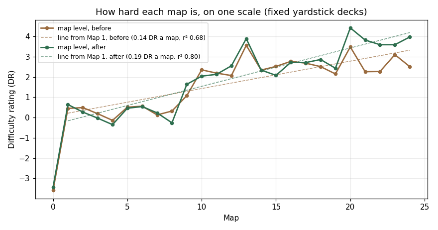

# The level curve, 2026-10-19 (package LV)

Owner (00:19, the overnight plan's last step): **"balance level to balance with the overall linear increase in difficulty over time."**

Until today the road's curve (90% → 60%, boss 30–49%, against each map's reference player) was held up by hand-set Shields: 96 fights had a `shieldOverride`, 47 of them over twice the rule, the biggest 33× (1-1: 33 against a rule of 1) and up to 252 (17-A-4). This package replaces them with level curves: the enemy's card level and your expected card level now rise in straight lines, the Shield follows the rule again, and every fight was retuned onto its band with deck moves first.

The spreadsheet is `docs/level-curve-2026-10-19.xlsx` (sheets **Curves**, **Absolute** with the chart, **Fights**, **Overrides**, **Changes**, **Floors**, **Economy**, **Decks**). The chart is also `docs/level-curve-2026-10-19.png`.

## In short

- **The enemy's level is a straight line now:** its cards fight **1.25% stronger every map after Map 4**: +10% (Lv 3) at Map 12, +20% (Lv 6) at Map 20, +30% (Lv 9) at Map 28. A boss fights two maps further on. Before, it moved in two stairs (Lv 3 at Map 10, Lv 6 only for the Map 20 boss), and the Map 20 world boss fought at its printed level.
- **Your expected level follows what the Forge lets you have:** Lv 0 (every card at its own starting level) to Map 10, because the Forge opens on Map 11; **Lv 3 from Map 11**; then from Map 16 (the Lv 5+ gate) 6% more of your deck at Lv 6 each map (Lv 4.6 at Map 24). This answers the W2 question ("if players don't really reach Lv 3 by Map 10, lower the curve"): they can't, so the curve is lower on Maps 1–10, and Map 10 lost its old Lv 3.
- **A fractional level is a per-copy mix** (Lv 4.5 = half the copies at Lv 3, half at Lv 6), as the game's per-copy levels work. That is how a curve of +10% stair-steps becomes a line.
- **Shield overrides: 96 → 35, none over 2× the rule** (was 47 over 2×; the Shield above the rule summed 2,794 → 358). Lower Health: 53 fights → 2. 23 of the 35 are on main maps.
- **The curve:** all **179 main-map fights green** on the measure seeds (120 games), 151 on fresh seeds, 174 on the mean of both. Side maps on the curve: 76 of 77 (the Eye of the Volcano's four-wave dungeon can't be simulated).
- **Absolute difficulty** (fixed yardstick decks, below) now rises **0.19 DR a map** from Map 1 with r² 0.80, against 0.135 and r² 0.68 before. The late maps no longer go flat. Two bumps stay: Map 13 (+1.8) and Map 20 (+1.0). Both come from reference decks that counter their own map; see the owner decisions.
- **Side maps:** the Eye of the Volcano's elites (97–100% before) and the Old Bramble are on the curve now and tuned. The Pale Desert is back on its curve after the new levels.
- **Endless dungeons:** +4% a floor compounding (floor 10 +36%, floor 50 +196%) is gone. **A floor now counts as half a map further down the road**, for the enemy's level and the Shield. The Murgle King on floor 10 is 38% for a Map 6 deck (was 0%), and a player of the map a floor counts as wins 57–85% there. The Long Burrow got a real deck: its diggers had been 100% on every floor.

## How difficulty is measured

The road curve measures each fight against **its own map's** reference player, so it can't show whether Map 14 is harder than Map 9. To see that, **four fixed yardstick decks** play every fight. They are frozen in `tools/level_curve_2026_10_19.js` and never change:

| Yardstick | Deck | Level | Rating |
|---|---|---|---|
| Y0 | the Otter starter | printed | −3.9 |
| Y8 | the Map 8 road deck | Lv 1 | 0 (the anchor) |
| Y16 | the Map 16 road deck | Lv 3 | +2.5 |
| Y24 | the Map 24 road deck | Lv 6 | +4.2 |

- Each fight is played as the game builds it: its levels, bramble, rules, CPU level. The yardsticks get 48 games each on their own seeds, 6100 + 37g.
- `fit` puts every fight and yardstick on one logistic scale (Bradley–Terry, maximum likelihood): a fight's **Difficulty Rating (DR)**.
  - +1 DR is the step from a 73% fight to a 50% one for the same deck.
  - One card-level stat step (+10%) is worth about **0.75 DR**: Map 16's deck at Lv 1 rates 1.65, at Lv 3 2.47.
- A map's **level (ML)** is the rating a player needs for its fights to land exactly on their curve targets: the mean of D + logit(target). The within-map shape (90% → 40%) cancels out of it.
  - On a map tuned to the curve, ML equals the reference player's own rating there.
  - **ML over the maps is the road's absolute difficulty**, and its straight-line fit is the trend.

## The curves

<!-- lv:curves -->
| Map | Enemy level (skirmish / boss) | Enemy stats | Your level | Your stats | Shield by rule (skirmish / elite / mini-boss / boss) |
|---|---|---|---|---|---|
| 0 | 0 / 0 | +0% | 0 | +0% | 0 / 0 / 0 / 0 |
| 1 | 0 / 0 | +0% | 0 | +0% | 1 / 2 / 2 / 3 |
| 2 | 0 / 0 | +0% | 0 | +0% | 2 / 3 / 4 / 6 |
| 3 | 0 / 1.25 | +0% | 0 | +0% | 3 / 5 / 6 / 9 |
| 4 | 0 / 1.5 | +0% | 0 | +0% | 4 / 6 / 8 / 12 |
| 5 | 1.25 / 1.75 | +1.3% | 0 | +0% | 5 / 8 / 10 / 15 |
| 6 | 1.5 / 2 | +2.5% | 0 | +0% | 6 / 9 / 12 / 18 |
| 7 | 1.75 / 2.25 | +3.8% | 0 | +0% | 7 / 11 / 14 / 21 |
| 8 | 2 / 2.5 | +5% | 0 | +0% | 8 / 12 / 16 / 24 |
| 9 | 2.25 / 2.75 | +6.3% | 0 | +0% | 9 / 14 / 18 / 27 |
| 10 | 2.5 / 3 | +7.5% | 0 | +0% | 10 / 15 / 20 / 30 |
| 11 | 2.75 / 3.38 | +8.8% | 3 | +10% | 11 / 17 / 22 / 33 |
| 12 | 3 / 3.75 | +10% | 3 | +10% | 12 / 18 / 24 / 36 |
| 13 | 3.38 / 4.13 | +11.3% | 3 | +10% | 13 / 20 / 26 / 39 |
| 14 | 3.75 / 4.5 | +12.5% | 3 | +10% | 14 / 21 / 28 / 42 |
| 15 | 4.13 / 4.88 | +13.8% | 3 | +10% | 15 / 23 / 30 / 45 |
| 16 | 4.5 / 5.25 | +15% | 3.18 | +10.6% | 16 / 24 / 32 / 48 |
| 17 | 4.88 / 5.63 | +16.3% | 3.36 | +11.2% | 17 / 26 / 34 / 51 |
| 18 | 5.25 / 6 | +17.5% | 3.54 | +11.8% | 18 / 27 / 36 / 54 |
| 19 | 5.63 / 6.38 | +18.8% | 3.72 | +12.4% | 19 / 29 / 38 / 57 |
| 20 | 6 / 6.75 | +20% | 3.9 | +13% | 20 / 30 / 40 / 60 |
| 21 | 6.38 / 7.13 | +21.3% | 4.08 | +13.6% | 21 / 32 / 42 / 63 |
| 22 | 6.75 / 7.5 | +22.5% | 4.26 | +14.2% | 22 / 33 / 44 / 66 |
| 23 | 7.13 / 7.88 | +23.8% | 4.44 | +14.8% | 23 / 35 / 46 / 69 |
| 24 | 7.5 / 8.25 | +25% | 4.62 | +15.4% | 24 / 36 / 48 / 72 |
<!-- /lv:curves -->

### (a) The enemy's level

`ROAD_LEVEL_CURVE` and `roadEnemyLevelExact` in `arena_app.js`.

- **The line:** gain = 1.25% × (map − 4), turned into the level that gives that gain (`levelForGain`: +10% = Lv 3, +20% = Lv 6, +30% = Lv 9) and split over the deck's copies (`levelMixDeck`).
- **Which map counts:** the map the fight counts as (`nodeMapNumber`), as for the Shield rule:
  - a side map counts as its parent;
  - T-2, T-3 and T-4 count as Maps 1, 8 and 18;
  - the Old Bramble counts as Map 17.
- **Bosses:** a boss, the campaign boss and the world boss fight two maps further on. Elites and mini-bosses stay on their map's line.
- **Display:** `roadEnemyLevel` (the battle rating, the editor) is the nearest whole level. Each copy in a fight shows its own real level.
- **Why 1.25%:** with the bramble back on the rule and no overrides, this slope left the map means within about ±0.5 DR of their curve on 19 of 25 maps (`docs/balance/skirmish-pass-lv-rule.jsonl`). A steeper line made the late maps too hard for the reference player; a flatter one brought the big Shields back.

### (b) Your expected level (the reference player)

`referencePlayerLevel`. `node tools/level_curve_2026_10_19.js econ` checks it against the economy (`docs/balance/level-curve-economy.json`). The table below is a player who:
- plays a map a day;
- earns first clears, side maps and the dungeons' floors, plus ~640 Dust a day of notices and weeklies (`docs/forge-economy-v2-2026-10-11.md`);
- spends 3/4 of it on levelling their road deck, cheapest stat step first, each copy on its own.

The deck changes from map to map, so new cards start again from their own level.

<!-- lv:economy -->
| Map | Dust earned (a map a day) | Deck stats (3/4 of the Dust, a map a day) | Copies by level | Light player (half the notices) |
|---|---|---|---|---|
| 1 | 257 | +0% | 4xL0 16xL1 | +0% |
| 2 | 397 | +0% | 4xL0 16xL1 | +0% |
| 3 | 594 | +0% | 4xL0 16xL1 | +0% |
| 4 | 284 | +0% | 4xL0 16xL1 | +0% |
| 5 | 884 | +0% | 8xL0 12xL1 | +0% |
| 6 | 1094 | +0% | 4xL0 16xL1 | +0% |
| 7 | 2567 | +0% | 4xL0 16xL1 | +0% |
| 8 | 933 | +0% | 4xL0 16xL1 | +0% |
| 9 | 965 | +0% | 4xL0 16xL1 | +0% |
| 10 | 924 | +0% | 4xL0 16xL1 | +0% |
| 11 | 1410 | +12% | 20xL3 | +12% |
| 12 | 1467 | +12% | 20xL3 | +12% |
| 13 | 924 | +12% | 20xL3 | +12% |
| 14 | 992 | +10% | 20xL3 | +10% |
| 15 | 1289 | +10% | 20xL3 | +10% |
| 16 | 1025 | +14.5% | 11xL3 9xL6 | +10.5% |
| 17 | 924 | +16% | 8xL3 12xL6 | +11.5% |
| 18 | 1061 | +14.5% | 11xL3 9xL6 | +10.5% |
| 19 | 1077 | +17% | 6xL3 14xL6 | +12.5% |
| 20 | 1445 | +14% | 1xL1 10xL3 9xL6 | +11.5% |
| 21 | 2116 | +17.5% | 5xL3 15xL6 | +15% |
| 22 | 904 | +17.5% | 5xL3 15xL6 | +14% |
| 23 | 2519 | +14.5% | 11xL3 9xL6 | +13.5% |
| 24 | 944 | +15% | 10xL3 10xL6 | +13% |
<!-- /lv:economy -->

- **Maps 0–10: Lv 0.** The Forge opens on Map 11, so no card can be levelled before it. Base cards stay at Lv 0 and rewards at Lv 1.
  - The old curve gave Map 0's starter and the Otter Centurion +10%.
  - It also gave every card +10% on Map 10, which no player can have there.
- **Map 11: Lv 3.** The ~3,800–6,700 Dust banked by Map 11 pays for the whole deck's Lv 3 (~2,300) at once, even for a light player.
- **Maps 16–24: rising.** Lv 6 is gated to Map 16 and costs ~9,000 Dust a deck. Players get there a few copies at a time: 5–50% of the deck by Map 24 in the light and full cases.
  - The curve takes the middle: **6% of the copies a map**, which is Lv 4.62 (+15.4% stats) at Map 24.
  - Lv 9 opens on Map 26; the curve reaches Lv 6 by Map 31.

### (c) The Shield

- **The rule is unchanged:** map number × 1 (skirmish), × 1.5 (elite), × 2 (mini-boss), × 3 (boss).
- **An override is now a last resort.** The tuner moves the deck first, then searches a Shield between 0 and **2× the rule**, then a lower Health (never under 60% of the bramble's own).
- **35 overrides are left.** Each is listed under "Shield overrides" with its value against the rule.

### (d) The bramble's Health

- **No per-map Health curve.** Health is the bramble's own:
  - Maps 1–10 use their map's castle at its kind's castle level (22–37 Health);
  - every other map uses the plain 30-Health bramble;
  - Map 0's base bramble has 10–20 Health.
- **The growth along the road comes from the Shield rule:** +1 a map for a skirmish, ×1.5 / ×2 / ×3 by kind.
- **Health lowerings:** 53 fights had an `hqHp` under the bramble's own Health; 2 still do.
  - 4-1: 19 of 22. Sunken Hollow's first fight stays hard for the Map 4 deck.
  - 4-5: 15 of 25. The Drowned Colossus.

## Absolute difficulty, before and after

<!-- lv:absolute -->
| Map | Map level before | off the line before | Map level after | off the line after | Your rating after (R_ref) |
|---|---|---|---|---|---|
| 0 | -3.59 | – | -3.43 | – | -3.42 |
| 1 | 0.45 | 0.23 | 0.64 | 0.81 | 0.7 |
| 2 | 0.49 | 0.14 | 0.27 | 0.25 | 0.15 |
| 3 | 0.19 | -0.3 | -0.03 | -0.24 | 0.06 |
| 4 | -0.14 | -0.76 | -0.35 | -0.75 | -0.24 |
| 5 | 0.51 | -0.24 | 0.46 | -0.13 | 0.41 |
| 6 | 0.56 | -0.33 | 0.54 | -0.24 | 0.64 |
| 7 | 0.13 | -0.89 | 0.23 | -0.74 | 0.07 |
| 8 | 0.32 | -0.84 | -0.26 | -1.42 | -0.36 |
| 9 | 1.08 | -0.21 | 1.64 | 0.29 | 1.68 |
| 10 | 2.35 | 0.92 | 2.04 | 0.5 | 1.98 |
| 11 | 2.19 | 0.63 | 2.13 | 0.4 | 2.32 |
| 12 | 2.07 | 0.37 | 2.55 | 0.63 | 2.52 |
| 13 | 3.56 | 1.73 | 3.89 | 1.78 | 3.93 |
| 14 | 2.34 | 0.37 | 2.34 | 0.04 | 2.26 |
| 15 | 2.52 | 0.42 | 2.08 | -0.4 | 1.96 |
| 16 | 2.77 | 0.53 | 2.72 | 0.05 | 2.82 |
| 17 | 2.68 | 0.31 | 2.71 | -0.15 | 2.77 |
| 18 | 2.51 | 0 | 2.86 | -0.19 | 3.03 |
| 19 | 2.15 | -0.49 | 2.43 | -0.81 | 2.62 |
| 20 | 3.48 | 0.71 | 4.42 | 0.99 | 4.83 |
| 21 | 2.26 | -0.65 | 3.82 | 0.2 | 3.74 |
| 22 | 2.27 | -0.77 | 3.59 | -0.22 | 3.65 |
| 23 | 3.1 | -0.08 | 3.59 | -0.41 | 3.58 |
| 24 | 2.51 | -0.8 | 3.97 | -0.22 | 4.12 |
<!-- /lv:absolute -->

Trend from Map 1, in DR a map:

| | Slope | r² | rms |
|---|---|---|---|
| Before | 0.135 | 0.68 | 0.64 |
| After | **0.189** | **0.80** | 0.65 |

Map 0 is the starter deck's own world, 3–4 DR under Map 1, so the line starts at Map 1.

- **Before, the road had three parts:**
  - flat on Maps 1–9 (~0.3);
  - a cliff at Map 10, where both sides jumped to Lv 3;
  - flat again on Maps 10–24 (~2.5). The Quiet Summit to Goldfeather Keep (21–24) sat 0.65–0.8 DR under the line, because their Shields carried the curve and the enemy cards never got stronger.
- **After:**
  - the late maps climb (21–24 are now 3.6–4.0, within ~0.4 of the line);
  - the Map 10 level cliff is gone (Map 10 lost the Lv 3 no player has there). The road's biggest step is now Map 8 → 9 (+1.9 DR), where the Map 8 rewards come into the deck.
- **Bumps left (more than 0.8 DR off the line):**
  - **Map 13, The Redwood Deep: +1.8.** Its reference deck (Trapdoor Spiders, Giant Cave Huntsmen, Wolf Spider Mothers, Quillguards) counters the Redwood's bears and boars. Its fights had to be made strong for that deck, so they are hard for any other deck.
  - **Map 20, The Sundered Peak: +1.0.** The same effect.
  - **Map 8, Caves & Alcoves: −1.4.** Its deck is weak in the caves. The Map 8 rewards (Giant Cave Huntsman, Trapdoor Spider) make the Map 9 deck much stronger, so the road jumps there.
  - **Map 1: +0.8.**

  These follow the decks, not the levels: on a map tuned to the curve, its level equals its reference deck's strength on that map. "Decisions for the owner" has the ways to flatten them.

## Shield overrides

| | Before | After |
|---|---|---|
| Fights with a Shield override | 96 (93 main, 3 side) | **35** (23 main, 12 side) |
| Over 2× the rule | 47 | **0** |
| Under the rule (an easier fight) | 30 | 16 |
| Biggest | 33× (1-1: 33, rule 1); 252 on 17-A-4 (rule 51) | 2.0× |
| Shield above the rule, summed | 2,794 | 358 |
| Fights with a lower Health | 53 | 2 |

<!-- lv:overrides -->
| Fight | Kind | Rule Shield | Before | After |
|---|---|---|---|---|
| 1-1 | skirmish | 1 | Shield 33, Health 14 of 24 | rule |
| 1-2 | skirmish | 1 | Shield 4, Health 15 of 24 | rule |
| 1-3 | skirmish | 1 | rule, Health 15 of 24 | rule |
| 1-4 | skirmish | 1 | rule, Health 14 of 24 | rule |
| 1-5 | elite | 2 | Shield 37 | Shield 3 |
| 2-2 | skirmish | 2 | rule, Health 26 of 30 | rule |
| 3-1 | skirmish | 3 | Shield 5, Health 21 of 30 | rule |
| 3-2 | skirmish | 3 | Shield 16 | rule |
| 3-3 | skirmish | 3 | Shield 13 | rule |
| 3-4 | skirmish | 3 | Shield 16 | rule |
| 3-5 | elite | 5 | Shield 39 | rule |
| 3-6 | elite | 5 | Shield 22 | rule |
| 3-7 | elite | 5 | Shield 40 | Shield 7 |
| 4-1 | skirmish | 4 | rule, Health 14 of 22 | Shield 0, Health 19 of 22 |
| 4-3 | elite | 6 | Shield 1 | rule |
| 4-5 | elite | 6 | Shield 0, Health 10 of 25 | Shield 0, Health 15 of 25 |
| 5-3 | skirmish | 5 | Shield 2 | rule |
| 5-4 | skirmish | 5 | Shield 11, Health 20 of 30 | rule |
| 5-6 | elite | 8 | Shield 11 | rule |
| 6-2 | skirmish | 6 | Shield 31 | Shield 0 |
| 6-4 | skirmish | 6 | Shield 2 | rule |
| 6-5 | elite | 9 | Shield 11 | rule |
| 6-7 | elite | 9 | Shield 0, Health 22 of 29 | rule |
| 6-8 | miniboss | 12 | Shield 31 | Shield 24 |
| 7-1 | skirmish | 7 | rule, Health 14 of 30 | Shield 0 |
| 7-2 | skirmish | 7 | rule, Health 25 of 30 | rule |
| 7-3 | skirmish | 7 | Shield 1, Health 14 of 30 | rule |
| 7-6 | miniboss | 14 | Shield 2 | rule |
| 8-1 | skirmish | 8 | rule, Health 14 of 22 | rule |
| 8-5 | skirmish | 8 | Shield 20 | rule |
| 8-6 | skirmish | 8 | Shield 0 | rule |
| 8-7 | elite | 12 | Shield 18, Health 19 of 23 | rule |
| 8-8 | miniboss | 16 | Shield 2 | Shield 1 |
| 9-1 | skirmish | 9 | rule, Health 22 of 30 | rule |
| 9-2 | skirmish | 9 | rule, Health 15 of 30 | rule |
| 9-3 | skirmish | 9 | Shield 21, Health 16 of 30 | rule |
| 9-6 | elite | 14 | Shield 9, Health 26 of 30 | rule |
| 9-7 | miniboss | 18 | Shield 53 | rule |
| 10-2 | skirmish | 10 | Shield 50 | rule |
| 10-5 | skirmish | 10 | Shield 0, Health 16 of 24 | rule |
| 10-6 | elite | 15 | Shield 30 | rule |
| 10-7 | elite | 15 | Shield 13 | rule |
| 10-8 | elite | 15 | rule, Health 25 of 27 | rule |
| 10-9 | boss | 30 | Shield 0 | rule |
| 11-1 | skirmish | 11 | rule, Health 14 of 30 | rule |
| 11-10 | miniboss | 22 | Shield 91 | Shield 43 |
| 11-4 | skirmish | 11 | Shield 7, Health 23 of 30 | rule |
| 11-5 | elite | 17 | Shield 4 | rule |
| 11-6 | elite | 17 | Shield 68, Health 25 of 30 | rule |
| 11-7 | elite | 17 | Shield 5 | rule |
| 11-8 | elite | 17 | Shield 103 | rule |
| 12-1 | skirmish | 12 | rule, Health 29 of 30 | rule |
| 12-2 | skirmish | 12 | Shield 0, Health 21 of 30 | rule |
| 12-3 | skirmish | 12 | rule, Health 29 of 30 | rule |
| 12-4 | skirmish | 12 | Shield 29, Health 15 of 30 | rule |
| 12-5 | elite | 18 | rule, Health 26 of 30 | rule |
| 12-7 | miniboss | 24 | Shield 47 | rule |
| 13-1 | skirmish | 13 | rule, Health 14 of 30 | rule |
| 13-2 | skirmish | 13 | rule, Health 14 of 30 | rule |
| 13-3 | skirmish | 13 | Shield 48 | rule |
| 13-4 | skirmish | 13 | Shield 20, Health 16 of 30 | rule |
| 13-6 | elite | 20 | rule, Health 26 of 30 | rule |
| 13-7 | elite | 20 | Shield 60 | rule |
| 13-8 | miniboss | 26 | Shield 44 | rule |
| 14-5 | elite | 21 | Shield 49 | rule |
| 14-7 | elite | 21 | Shield 63 | rule |
| 14-8 | miniboss | 28 | rule, Health 30 of 31 | rule |
| 15-2 | skirmish | 15 | rule, Health 20 of 30 | rule |
| 15-3 | skirmish | 15 | Shield 2, Health 15 of 30 | rule |
| 15-4 | skirmish | 15 | Shield 51 | rule |
| 15-5 | elite | 23 | Shield 84 | rule |
| 15-6 | elite | 23 | Shield 30 | rule |
| 15-7 | boss | 45 | Shield 61 | rule |
| 16-2 | skirmish | 16 | Shield 51 | rule |
| 16-3 | skirmish | 16 | Shield 109 | Shield 32 |
| 16-4 | skirmish | 16 | Shield 54 | rule |
| 16-5 | elite | 24 | Shield 49 | rule |
| 16-6 | elite | 24 | Shield 143, Health 25 of 30 | Shield 42 |
| 16-7 | miniboss | 32 | Shield 104 | rule |
| 17-2 | skirmish | 17 | Shield 65, Health 14 of 34 | rule |
| 17-3 | skirmish | 17 | rule, Health 14 of 34 | rule |
| 17-4 | skirmish | 17 | Shield 122 | rule |
| 17-6 | elite | 26 | Shield 6 | rule |
| 17-7 | elite | 26 | Shield 193, Health 25 of 37 | rule |
| 17-8 | miniboss | 34 | Shield 125, Health 30 of 37 | Shield 68 |
| 18-2 | skirmish | 18 | Shield 36 | rule |
| 18-4 | skirmish | 18 | Shield 34 | rule |
| 18-5 | elite | 27 | Shield 44 | rule |
| 19-2 | skirmish | 19 | Shield 101 | rule |
| 19-4 | elite | 29 | Shield 23 | rule |
| 19-5 | elite | 29 | Shield 103 | rule |
| 19-6 | miniboss | 38 | Shield 163 | rule |
| 20-10 | worldboss | 60 | Shield 78 | rule |
| 20-2 | skirmish | 20 | Shield 35, Health 25 of 30 | rule |
| 20-4 | skirmish | 20 | Shield 120 | rule |
| 20-5 | elite | 30 | Shield 20 | rule |
| 20-8 | elite | 30 | Shield 33 | rule |
| 21-1 | skirmish | 21 | Shield 63 | rule |
| 21-2 | skirmish | 21 | Shield 0 | rule |
| 21-3 | skirmish | 21 | Shield 0 | rule |
| 21-4 | elite | 32 | Shield 6 | Shield 29 |
| 21-5 | elite | 32 | Shield 7 | rule |
| 21-6 | miniboss | 42 | Shield 78 | Shield 79 |
| 22-3 | skirmish | 22 | Shield 1 | rule |
| 22-4 | skirmish | 22 | Shield 0 | rule |
| 22-5 | skirmish | 22 | Shield 66 | rule |
| 22-6 | elite | 33 | Shield 0 | rule |
| 22-8 | miniboss | 44 | Shield 72 | Shield 64 |
| 23-6 | elite | 35 | Shield 45 | rule |
| 24-2 | skirmish | 24 | Shield 96 | rule |
| 24-6 | elite | 36 | Shield 75 | Shield 49 |
| 24-7 | elite | 36 | Shield 17 | rule |
| 24-8 | miniboss | 48 | Shield 11 | rule |
| 1-A-1 | skirmish | 1 | rule, Health 10 of 24 | rule |
| 1-A-2 | skirmish | 1 | rule, Health 13 of 24 | rule |
| 1-A-3 | skirmish | 1 | rule, Health 13 of 24 | Shield 0 |
| 1-A-4 | skirmish | 1 | rule, Health 15 of 24 | rule |
| 2-A-1 | skirmish | 6 | rule, Health 19 of 30 | rule |
| 2-A-2 | skirmish | 6 | rule, Health 28 of 30 | rule |
| 2-A-3 | skirmish | 6 | rule, Health 18 of 30 | rule |
| 2-A-4 | skirmish | 6 | rule, Health 15 of 30 | rule |
| 2-A-6 | elite | 9 | rule, Health 27 of 33 | rule |
| 2-A-7 | boss | 18 | rule, Health 30 of 38 | rule |
| 14-A-1 | skirmish | 14 | rule, Health 19 of 28 | rule |
| 17-A-2 | skirmish | 17 | Shield 74 | rule |
| 17-A-3 | skirmish | 17 | Shield 116 | Shield 5 |
| 17-A-4 | boss | 51 | Shield 252 | Shield 38 |
| 4-2 | skirmish | 4 | rule | Shield 1 |
| 4-4 | elite | 6 | rule | Shield 5 |
| 14-6 | elite | 21 | rule | Shield 10 |
| 20-3 | skirmish | 20 | rule | Shield 15 |
| 20-6 | elite | 30 | rule | Shield 53 |
| 20-7 | elite | 30 | rule | Shield 25 |
| 23-1 | skirmish | 23 | rule | Shield 41 |
| 0-B-4 | boss | 51 | rule | Shield 94 |
| T-4 | elite | 27 | rule | Shield 53 |
| 5-A-1 | skirmish | 5 | rule | Shield 8 |
| 10-A-1 | skirmish | 10 | rule | Shield 8 |
| 10-A-3 | skirmish | 10 | rule | Shield 14 |
| 10-A-4 | elite | 15 | rule | Shield 9 |
| 11-A-3 | skirmish | 11 | rule | Shield 18 |
| 19-A-10 | boss | 57 | rule | Shield 87 |
| 20-A-5 | elite | 30 | rule | Shield 60 |
<!-- /lv:overrides -->

## The retune

1. **Back on the rule.** `tools/level_curve_2026_10_19.js strip` took every `shieldOverride` and every Health-lowering `hqHp` off: 127 fights. The record is `docs/balance/level-curve-overrides-before.json`.
2. **Reference decks rebuilt** with the new levels: `tools/skirmish_pass.js decks --keep`, Maps 1–24.
   - Most decks changed, because Maps 1–10 now play at Lv 0. `WINRATE_REF_DECKS` and `docs/balance/skirmish-pass-decks.json` hold them; the decks before are in `level-curve-decks-before.json`.
3. **On the rule, before any tuning,** 89 of 179 main fights were already green (`skirmish-pass-lv-rule.jsonl`).
4. **Four tune rounds.** Each used `tools/skirmish_pass.js curve --rule --shieldx=2 --hpfloor=0.6 --any`, with deck moves first, inside the map's theme and the road's rarity caps.

   | Round | Seeds | Fights tuned | Green on the round's own seeds |
   |---|---|---|---|
   | 1 | tune seeds (7300), 60 games | 150 off on the rule | 146 |
   | 2 | 7300, 100 games | 59 off after round 1 (measure seeds) | 55 |
   | 3 | the measure seeds (9100), 120 games | 30 off after round 2 | 28 |
   | 4 | a third set (1300), 120 games | 14 off on the mean of measure and fresh seeds | 11 |

   Plus 7 fights by hand (`level-curve-fixes-hand.jsonl`: 11-10, 15-3, 18-A-1, 18-A-5, 19-A-7, 20-A-4, 20-A-5).

<!-- lv:maps -->
| Map | Fights | Green before (with overrides) | Green on the rule, no overrides, new curves | Green after | Green on fresh seeds |
|---|---|---|---|---|---|
| 0 | 4 | 4 | 3 | 4 | 2 |
| 1 | 5 | 5 | 2 | 5 | 5 |
| 2 | 5 | 5 | 3 | 5 | 5 |
| 3 | 7 | 7 | 4 | 7 | 5 |
| 4 | 5 | 5 | 1 | 5 | 5 |
| 5 | 7 | 7 | 6 | 7 | 5 |
| 6 | 8 | 8 | 5 | 8 | 8 |
| 7 | 6 | 6 | 2 | 6 | 6 |
| 8 | 8 | 8 | 2 | 8 | 6 |
| 9 | 7 | 7 | 4 | 7 | 7 |
| 10 | 9 | 9 | 3 | 9 | 9 |
| 11 | 10 | 10 | 4 | 10 | 7 |
| 12 | 7 | 7 | 4 | 7 | 6 |
| 13 | 8 | 8 | 5 | 8 | 5 |
| 14 | 8 | 8 | 5 | 8 | 7 |
| 15 | 7 | 7 | 0 | 7 | 6 |
| 16 | 7 | 7 | 5 | 7 | 5 |
| 17 | 8 | 8 | 5 | 8 | 7 |
| 18 | 7 | 7 | 6 | 7 | 7 |
| 19 | 6 | 6 | 4 | 6 | 4 |
| 20 | 10 | 10 | 3 | 10 | 9 |
| 21 | 6 | 6 | 2 | 6 | 4 |
| 22 | 8 | 8 | 2 | 8 | 6 |
| 23 | 8 | 8 | 4 | 8 | 7 |
| 24 | 8 | 8 | 5 | 8 | 8 |
<!-- /lv:maps -->

**Fresh seeds** (5100, nothing tuned there): 151 of 179 green, 174 on the mean of both. At 120 games one seed set has a spread of ±4.5 points, so a fight on target misses ±8 on the other set about 1 time in 10. Two fights miss by more than 5 points:
- 11-9 The Condor Sovereign: 40% fresh, 62.5% measure;
- 12-6 Rodent Court: 42% fresh, 53% measure.

The earlier passes had the same spread: 151–157 on fresh seeds.

## Side maps

- **The Eye of the Volcano (20-A)** is on the curve now:
  - its three gate elites and three roaming elites run 90 → 60%;
  - the Heart of the Mountain (20-A-4) is its boss fight (`ROAD_CURVE_ENDER`).
  - The roaming elites had been 97–100%. They now take the Sundered Peak family's cards that the theme allows (Pack Mules, Cinder Stokers, Gorge Wyrms, a Silverback). 20-A-5 has a Shield of 60, 2× the rule.
  - **The Heart of the Mountain is a four-wave dungeon.** The reference fight plays only its first wave (100%), so it is left as it was and not tuned.
- **The Old Bramble (0-B)** counts as Map 17 and is on the curve now, with the Map 17 deck. It fights the Map 17 enemy level (it was printed). Its boss has a Shield of 94 (rule 51).
- **The Pale Desert (18-A)** is on its curve again. Two hand moves (18-A-1, 18-A-5) keep the trail falling. Its stored measure is refreshed (`tests/pale-desert-2026-10-19.js --measure`).
- **The Tutorial's come-back fights (T-2 to T-4) and the Volcano Lair (20-B)** keep their older targets. All are inside them: T-4 has a Shield of 53 (rule 27).

## Endless dungeons

The owner's open question was: "Only +4% stats a floor now. Add shield too, or a gentler step? Murgle King floor 10 is 0% for a Map 6 deck."

- **Before:** +4% compounded made floor 10 +36% and floor 50 +196%. The Shield stayed the parent map's on every floor.
- **Now** (`ENDLESS_FLOOR_CURVE`): **floor f counts as the parent map + (f − 1) × 0.5**, for the enemy's level (the road's own line) and the Shield. There is no extra stat bonus (`floorPct` 0; the knob stays).
  - A floor past Lv 10 limit-breaks to Lv 11 (the Long Burrow from floor ~21).
  - So a Murgle floor plays like the road at the map it counts as: floor 30 counts as Map 20.5.
- **The Long Burrow** (Map 22) had a deck of commons that lost on every floor, floor 50 included (100% for the player).
  - It now fields the Caldera's badger warband: Badger Berserkers, Basalt and Grindstone Boars, Honey Badgers, Ore-smelter Moles, an Ür-Elk, and a Magma Titan for the Sett Lord.
  - Floor 1 is ~82% for the Map 22 deck.

<!-- lv:floors -->
| Dungeon | Floor | Counts as Map | Enemy level | Shield | Parent map's deck | The deck of the map it counts as |
|---|---|---|---|---|---|---|
| Murgle Mayhem (Map 6) | 1 | 6 | 1.5 | 6 | 60% | 60% |
| Murgle Mayhem (Map 6) | 2 | 6.5 | 1.63 | 7 | 58.3% | 58.3% |
| Murgle Mayhem (Map 6) | 5 | 8 | 2 | 8 | 63.3% | 75% |
| Murgle Mayhem (Map 6) | 9 | 10 | 2.5 | 10 | 43.3% | 56.7% |
| Murgle Mayhem (Map 6) | 10 | 10.5 | 2.63 | 21 | 38.3% | 43.3% |
| Murgle Mayhem (Map 6) | 15 | 13 | 3.38 | 13 | 25% | 81.7% |
| Murgle Mayhem (Map 6) | 19 | 15 | 4.13 | 15 | 25% | 85% |
| Murgle Mayhem (Map 6) | 20 | 15.5 | 4.31 | 31 | 15% | 68.3% |
| Murgle Mayhem (Map 6) | 25 | 18 | 5.25 | 18 | 16.7% | 65% |
| Murgle Mayhem (Map 6) | 30 | 20.5 | 6.19 | 41 | 5% | 63.3% |
| Murgle Mayhem (Map 6) | 39 | 25 | 7.88 | 25 | 3.3% | 81.7% |
| Murgle Mayhem (Map 6) | 40 | 25.5 | 8.06 | 51 | 3.3% | 71.7% |
| Murgle Mayhem (Map 6) | 50 | 30.5 | 9.63 | 61 | 1.7% | 70% |
| The Long Burrow (Map 22) | 1 | 22 | 6.75 | 22 | 81.7% | 81.7% |
| The Long Burrow (Map 22) | 2 | 22.5 | 6.94 | 23 | 75% | 75% |
| The Long Burrow (Map 22) | 5 | 24 | 7.5 | 24 | 65% | 71.7% |
| The Long Burrow (Map 22) | 9 | 26 | 8.25 | 26 | 61.7% | 70% |
| The Long Burrow (Map 22) | 10 | 26.5 | 8.44 | 53 | 68.3% | 63.3% |
| The Long Burrow (Map 22) | 15 | 29 | 9.25 | 29 | 58.3% | 68.3% |
| The Long Burrow (Map 22) | 19 | 31 | 9.75 | 31 | 55% | 65% |
| The Long Burrow (Map 22) | 20 | 31.5 | 9.88 | 63 | 48.3% | 61.7% |
| The Long Burrow (Map 22) | 25 | 34 | 10.25 | 34 | 50% | 60% |
| The Long Burrow (Map 22) | 30 | 36.5 | 10.56 | 73 | 36.7% | 55% |
| The Long Burrow (Map 22) | 39 | 41 | 11 | 41 | 26.7% | 50% |
| The Long Burrow (Map 22) | 40 | 41.5 | 11 | 83 | 28.3% | 48.3% |
| The Long Burrow (Map 22) | 50 | 46.5 | 11 | 93 | 25% | 46.7% |
<!-- /lv:floors -->

**Read across:**
- "Parent map's deck" is the player who just opened the dungeon. It falls steadily: Murgle 60% → 38% (the King on floor 10) → 25% → 5% by floor 30; the Long Burrow 82% → 25% at floor 50.
- "The deck of the map it counts as" is a player as far along the road as the floor. It stays at 57–85% on Murgle's floors and 43–72% on its Kings.
  - On the Long Burrow it falls under 50% past floor 39. That is past Map 24, where the last deck stands in.

## Decisions for the owner

1. **A truly straight road needs the decks to grow evenly.** On a map tuned to the curve, the map's absolute difficulty is its reference deck's strength there, and the levels can only add evenly. The bumps left (Maps 8, 13, 20) are the rewards and the per-map deck search:
   - the Map 8 rewards make Map 9's deck much stronger;
   - Map 13's deck counters its own map.

   Options:
   - (a) build each reference deck against Maps N−1..N+1, not N alone (less of a counter-deck; one change in `tools/skirmish_pass.js decks`);
   - (b) move a strong reward a map later (Giant Cave Huntsman);
   - (c) accept them.
2. **The Forge on Map 11 is the reason Maps 1–10 can't climb by level.** Their difficulty rises only with the rewards. If you want levels to start earlier, open the Forge (or Lv 0 → 1 "motes") sooner, and raise `ROAD_LEVEL_CURVE.playerForgeMap`.
3. **Your-level assumption.** The curve assumes a player who plays a map a day and puts 3/4 of their Dust into the deck. Slower players get more Dust a map; that is the same as a slightly easier road for them. `playerRisePerMap` (0.18 a map from Map 16) is the knob.
4. **The Heart of the Mountain** can't be balanced by simulation until the reference fight plays dungeon waves. It is unchanged.
5. **Endless floors:** half a map a floor. If you want the dungeons to stay harder for players as they progress, raise `floorMaps`, or set `floorPct` (e.g. 0.005).

## Files

- **`arena_app.js`:**
  - the curves: `ROAD_LEVEL_CURVE`, `LEVEL_STAT_STEPS`, `levelForGain`, `levelMix`, `levelMixDeck`, `referencePlayerLevel`, `roadMapOfFight`, `roadEnemyLevelExact` / `roadEnemyLevel`, `levelledEnemyDeck` (per-copy mixes);
  - the floors: `ENDLESS_FLOOR_CURVE`, `shieldMapOf`;
  - the curve's reach: `ROAD_CURVE_SKIP` / `ROAD_CURVE_ENDER` (the Eye of the Volcano and the Old Bramble on the curve);
  - the Long Burrow's deck; the retuned fights' decks, Shields and Health; `WINRATE_REF_DECKS`.
- **`tools/level_curve_2026_10_19.js`:** `abs` (the yardsticks), `fit`, `rule`, `strip`, `apply`, `curves`, `decks`, `floors`, `econ`.
- **`tools/level_curve_xlsx.py`:** the workbook, the chart and the tables in this doc.
- **`tools/skirmish_pass.js`:** `curve --rule --shieldx --hpfloor --any`.
- **`tools/lib_bramble.js`:** exports the new curve functions.
- **Data in `docs/balance/`:**
  - the yardstick measures: `lv-abs-before.jsonl`, `lv-abs-after.jsonl`;
  - the fits: `level-curve-fit-before.json`, `level-curve-fit-after.json`;
  - `level-curve-curves.json`, `level-curve-economy.json`;
  - the deck ratings: `level-curve-decks-a.json`, `level-curve-decks-b.json`;
  - the overrides: `level-curve-overrides-before.json`, `level-curve-overrides-after.json`;
  - the node snapshots: `level-curve-nodes-before.json`, `level-curve-nodes-after.json`;
  - the tune rounds: `level-curve-fixes.jsonl`, `-2`, `-3`, `-4`, `-hand`;
  - the reference measures: `skirmish-pass-lv-rule.jsonl`, `-lv-r1.jsonl`, `-lv-r2.jsonl`, `-lv-after.jsonl`, `-lv-fresh.jsonl`, `-lv-mean.jsonl`;
  - the floors: `level-curve-floors-*.json`.
- **Tests:**
  - `tests/level-curve-2026-10-19.js` (in `run-all.sh`): the curves, the floors, the override bounds, the bands, the absolute trend, the docs;
  - updated: `shields-2026-10-18.js` (the floors' Shield), `winrate-panel-2026-10-19.js` (Map 0 at Lv 0, the Eye and the Old Bramble on the curve), `thematic-2026-10-19.js` (reads the LV measure).

## Every fight

The columns:
- **Before:** the card pass's final measure, with the overrides.
- **On the rule:** the new levels and decks with no overrides, before any tuning.
- **After** and **Fresh seeds:** 120 games each.
- **DR:** the yardstick rating.

<!-- lv:fights -->
| Fight | Kind | Target (green) | Before | On the rule | After | Fresh seeds | DR before → after | What changed |
|---|---|---|---|---|---|---|---|---|
| 0-1 Otter Patrol | skirmish | 90% (82–98) | 87.5% | 86.7% | 87.5% | 89.2% | -6.1 → -5.98 | – |
| 0-2 Scorpion Ambush | skirmish | 75% (67–83) | 74.2% | 66.7% | 71.7% | 62.5% (red) | -4.97 → -4.66 | −2 Ant Scout; +2 Dynamite Packrat |
| 0-3 Raccoon Heist | skirmish | 60% (52–68) | 62.5% | 58.3% | 63.3% | 48.3% (red) | -3.33 → -3.22 | – |
| 0-4 Frost Vanguard | skirmish | 45% (30–49) | 44.2% | 36.7% | 41.7% | 43.3% | -3.48 → -3.38 | – |
| 1-1 Hedgerow Scouts | skirmish | 90% (82–98) | 92.5% | 98.3% | 90% | 90% | -1.67 → -0.71 | +2 Thornwood Palisade; Shield 33 (override) → 1 (rule); Health 14 → 24 |
| 1-2 Cricket Chorus | skirmish | 80% (72–88) | 84.2% | 78.3% | 84.2% | 83.3% | -1.09 → -0.91 | Shield 4 (override) → 1 (rule); Health 15 → 24 |
| 1-3 Burrow Line | skirmish | 70% (62–78) | 77.5% | 56.7% | 72.5% | 75% | -0.15 → -0.25 | −2 Burrow Rabbit; +2 Chipmunk Forager; Health 15 → 24 |
| 1-4 Sapper Hedge | skirmish | 60% (52–68) | 61.7% | 58.3% | 60.8% | 65.8% | -0.27 → 0.28 | Health 14 → 24 |
| 1-5 The Thistle Baron | elite | 40% (30–49) | 39.2% | 58.3% | 47.5% | 45% | 1.01 → 0.33 | −2 Beetle Grunt; +2 Ent; Shield 37 (override) → 3 (override) |
| 2-1 Rock Pool Raiders | skirmish | 90% (82–98) | 89.2% | 83.3% | 85% | 84.2% | -1.02 → -0.99 | – |
| 2-2 Gull Gang | skirmish | 80% (72–88) | 80.8% | 76.7% | 80% | 76.7% | -1.09 → -0.99 | Health 26 → 30 |
| 2-3 Hermit Row | skirmish | 70% (62–78) | 65.8% | 53.3% | 73.3% | 77.5% | 0.02 → -0.71 | −2 Mayfly Dancer; +2 Sea Turtle Elder |
| 2-4 Pelican Point | skirmish | 60% (52–68) | 52.5% | 43.3% | 63.3% | 65% | -0.34 → -0.64 | −2 Pelican Diver; +2 Sea Turtle Elder |
| 2-5 The Old Shell | elite | 40% (30–49) | 32.5% | 30% | 36.7% | 45.8% | 0.42 → 0.22 | +1 Pelican Diver; −2 Sulfur Vent Crab |
| 3-1 Goat Ledge | skirmish | 90% (82–98) | 92.5% | 86.7% | 90% | 87.5% | -1.67 → -1.45 | Shield 5 (override) → 3 (rule); Health 21 → 30 |
| 3-2 Hawk Watch | skirmish | 84% (76–92) | 91.7% | 90% | 90.8% | 93.3% (blue) | -1.5 → -1.79 | Shield 16 (override) → 3 (rule) |
| 3-3 Rockfall | skirmish | 78% (70–86) | 81.7% | 80% | 80% | 85% | -1.25 → -1.45 | Shield 13 (override) → 3 (rule) |
| 3-4 Condor Thermals | skirmish | 72% (64–80) | 74.2% | 71.7% | 74.2% | 69.2% | -1.02 → -1.45 | Shield 16 (override) → 3 (rule) |
| 3-5 Eagle Stoop | elite | 66% (58–74) | 69.2% | 80% | 69.2% | 68.3% | -0.34 → -0.64 | −3 Hawk Arrowkeeper; +2 Mountain Goat Climber; +1 Rockslide Ram; Shield 39 (override) → 5 (rule) |
| 3-6 Avalanche Pass | elite | 60% (52–68) | 58.3% | 68.3% | 56.7% | 60.8% | 0.31 → -0.25 | +2 Kittiwake Flock; Shield 22 (override) → 5 (rule) |
| 3-7 The Gannet Queen | elite | 40% (30–49) | 45% | 61.7% | 45% | 50% (blue) | 0.08 → 0.1 | +2 Grey Seal Bull; +2 Razorbill; +2 Tide Pool Crab; Shield 40 (override) → 7 (override) |
| 4-1 Reef Skirmishers | skirmish | 90% (82–98) | 86.7% | 63.3% | 88.3% | 84.2% | -2.92 → -2.99 | +2 Humpback Elder; −2 Pyrenean Desman; Shield 4 → 0 (override); Health 14 → 19 |
| 4-2 Tidal Ring | skirmish | 80% (72–88) | 77.5% | 75% | 75.8% | 80% | -2.21 → -2.91 | Shield 4 → 1 (override) |
| 4-3 Cetacean Pod | elite | 70% (62–78) | 73.3% | 50% | 67.5% | 65% | -0.73 → -0.91 | −2 Platypus Spur; +2 Pond Trout; Shield 1 (override) → 6 (rule) |
| 4-4 The Kraken's Maw | elite | 60% (52–68) | 62.5% | 51.7% | 65% | 60.8% | 0.37 → -0.25 | +2 Humpback Elder; −2 Orca Vanguard; Shield 6 → 5 (override) |
| 4-5 The Drowned Colossus | elite | 40% (30–49) | 40.8% | 26.7% | 31.7% | 41.7% | 0.37 → 0.88 | +1 Humpback Elder; −1 Orca Vanguard; Health 10 → 15 |
| 5-1 Leech Pools | skirmish | 90% (82–98) | 86.7% | 75% | 83.3% | 81.7% (red) | -1.02 → -1.54 | −2 Constrictor Coil; +2 Snapper Hatchling |
| 5-2 Toad Hollow | skirmish | 84% (76–92) | 89.2% | 90% | 87.5% | 80% | -1.67 → -1.62 | – |
| 5-3 Cypress Roots | skirmish | 78% (70–86) | 81.7% | 78.3% | 75.8% | 70.8% | -0.53 → -0.51 | Shield 2 (override) → 5 (rule) |
| 5-4 Snapping Reeds | skirmish | 72% (64–80) | 69.2% | 65% | 70% | 71.7% | -0.87 → -0.51 | Shield 11 (override) → 5 (rule); Health 20 → 30 |
| 5-5 Gator Slide | elite | 66% (58–74) | 73.3% | 63.3% | 70% | 65% | -0.09 → 0.16 | – |
| 5-6 Behemoth Bog | elite | 60% (52–68) | 63.3% | 58.3% | 52.5% | 67.5% | 0.2 → 0.05 | Shield 11 (override) → 8 (rule) |
| 5-7 Old Snapjaw | boss | 40% (30–49) | 32.5% | 41.7% | 44.2% | 53.3% (blue) | 0.85 → 0.44 | – |
| 6-1 Leech Bog | skirmish | 90% (82–98) | 95.8% | 93.3% | 91.7% | 93.3% | -0.87 → -0.57 | – |
| 6-2 Mire Ambush | skirmish | 85% (77–93) | 90% | 96.7% | 90% | 88.3% | -0.15 → -1.29 | +2 Caiman Hatchling; Shield 31 (override) → 0 (override) |
| 6-3 Toad Chorus | skirmish | 80% (72–88) | 86.7% | 76.7% | 78.3% | 82.5% | -1.5 → -1.54 | – |
| 6-4 Root Snare | skirmish | 75% (67–83) | 76.7% | 76.7% | 76.7% | 77.5% | -1.67 → -1.37 | Shield 2 (override) → 6 (rule) |
| 6-5 Venomlord's Coil | elite | 70% (62–78) | 73.3% | 70% | 69.2% | 70% | -0.09 → 0.22 | Shield 11 (override) → 9 (rule) |
| 6-6 Crocodile Run | elite | 65% (57–73) | 67.5% | 71.7% | 61.7% | 63.3% | 0.14 → 0.39 | – |
| 6-7 Adder Gauntlet | elite | 60% (52–68) | 65% | 40% | 65.8% | 60% | -0.03 → 0.1 | −2 Bogfire Newt; −1 Cottonmouth Matriarch; +3 Venomlord Serpent; Shield 0 (override) → 9 (rule); Health 22 → 29 |
| 6-8 The Alligator King | miniboss | 40% (30–49) | 42.5% | 50% | 42.5% | 48.3% | 0.75 → 0.5 | +1 Caiman Hatchling; −1 Marsh Wisp; +2 Raven Scout; Shield 31 (override) → 24 (override) |
| 7-1 Spore Drift | skirmish | 90% (82–98) | 94.2% | 80% | 84.2% | 86.7% | -2.3 → -1.62 | Shield 7 → 0 (override); Health 14 → 30 |
| 7-2 Grub Tunnels | skirmish | 82.5% (74.5–90.5) | 84.2% | 70% | 80% | 77.5% | -1.58 → -1.37 | +2 Garden Snail; −1 Trapdoor Spider; −1 Tunnel Wyrm; Health 25 → 30 |
| 7-3 Web Hollow | skirmish | 75% (67–83) | 74.2% | 25% | 77.5% | 75.8% | -0.87 → -1.37 | −2 Dung Beetle; +4 Honey Bee; −2 Trapdoor Spider; Shield 1 (override) → 7 (rule); Health 14 → 30 |
| 7-4 Moonlit Gills | skirmish | 67.5% (59.5–75.5) | 71.7% | 58.3% | 65.8% | 68.3% | -0.66 → -0.71 | −2 Fungal Colossus; +2 Garden Snail |
| 7-5 The Oath Ring | elite | 60% (52–68) | 59.2% | 53.3% | 53.3% | 55.8% | -0.46 → -0.19 | – |
| 7-6 The Morel Monarch | miniboss | 40% (30–49) | 37.5% | 33.3% | 37.5% | 44.2% | 1.07 → 1.04 | +1 Garden Snail; −1 Truffle Piglet; Shield 2 (override) → 14 (rule) |
| 8-1 Roost Flurry | skirmish | 90% (82–98) | 96.7% | 88.3% | 91.7% | 90.8% | -2.03 → -1.79 | Health 14 → 22 |
| 8-2 Glowworm Grotto | skirmish | 85% (77–93) | 86.7% | 80% | 78.3% | 78.3% | -1.76 → -1.71 | – |
| 8-3 Cinder Vents | skirmish | 80% (72–88) | 77.5% | 71.7% | 84.2% | 87.5% | -0.94 → -1.71 | −2 Barrow Leech; +2 Glowworm Cluster |
| 8-4 Echo Chamber | skirmish | 75% (67–83) | 72.5% | 65% | 73.3% | 65.8% (red) | -0.73 → -1.88 | −2 Cave Bat Swarm; +2 Glowworm Cluster |
| 8-5 Sulfur Vent Path | skirmish | 70% (62–78) | 66.7% | 81.7% | 68.3% | 60% (red) | -0.46 → -0.71 | +2 Cave Bat Swarm; Shield 20 (override) → 8 (rule) |
| 8-6 Glowworm Deep | skirmish | 65% (57–73) | 65% | 35% | 57.5% | 65% | -0.4 → -1.62 | +2 Cave Bat Swarm; −2 Giant Cave Huntsman; Shield 0 (override) → 8 (rule) |
| 8-7 The Roost Above | elite | 60% (52–68) | 59.2% | 30% | 64.2% | 58.3% | -0.21 → -1.14 | −2 Cave Bat Swarm; −2 Echo Screecher; +2 Glowworm Cluster; Shield 18 (override) → 12 (rule); Health 19 → 23 |
| 8-8 The Stalactite Warden | miniboss | 40% (30–49) | 35% | 16.7% | 35.8% | 34.2% | 1.22 → 0.61 | −2 Barrow Leech; +2 Cave Olm; +2 Glowworm Cluster; −2 Whip Spider; Shield 2 (override) → 1 (override) |
| 9-1 Mudflat Skippers | skirmish | 90% (82–98) | 90% | 88.3% | 84.2% | 82.5% | -1.02 → -0.44 | Health 22 → 30 |
| 9-2 Monitor Roots | skirmish | 84% (76–92) | 83.3% | 66.7% | 79.2% | 81.7% | -0.8 → -0.32 | −1 Nautilus Drifter; +1 Silver Minnow; Health 15 → 30 |
| 9-3 Kingfisher Dive | skirmish | 78% (70–86) | 80% | 56.7% | 75% | 76.7% | -1.41 → -1.37 | −2 Mangrove Mudskipper; +2 Silver Minnow; Shield 21 (override) → 9 (rule); Health 16 → 30 |
| 9-4 Kelp Curtains | skirmish | 72% (64–80) | 68.3% | 70% | 67.5% | 71.7% | 1.07 → 1.15 | – |
| 9-5 Moray Den | elite | 66% (58–74) | 73.3% | 73.3% | 66.7% | 71.7% | 0.37 → 1.87 | +2 Nautilus Drifter |
| 9-6 Drifting Shell | elite | 60% (52–68) | 64.2% | 58.3% | 60% | 62.5% | 1.12 → 1.72 | Shield 9 (override) → 14 (rule); Health 26 → 30 |
| 9-7 The Kelp Witch | miniboss | 40% (30–49) | 40% | 71.7% | 37.5% | 36.7% | 1.48 → 2.11 | +2 Electric Ray; +2 Nautilus Drifter; −2 Reef Shark; −2 Silver Minnow; Shield 53 (override) → 18 (rule) |
| 10-1 Clownfish Shoal | skirmish | 90% (82–98) | 90.8% | 88.3% | 83.3% | 85.8% | 0.64 → 0.61 | – |
| 10-2 Moray Ambush | skirmish | 85.7% (77.7–93.7) | 90% | 60% | 83.3% | 82.5% | 1.17 → 0.56 | +2 Glass Octopus; −2 Silver Minnow; Shield 50 (override) → 10 (rule) |
| 10-3 Tide Pool Line | skirmish | 81.4% (73.4–89.4) | 88.3% | 65% | 80% | 75.8% | 0.64 → -0.32 | −2 Sea Cucumber; +2 Silver Minnow |
| 10-4 Riptide Channel | skirmish | 77.1% (69.1–85.1) | 83.3% | 31.7% | 73.3% | 72.5% | 0.85 → 0.44 | −2 Coral Current Eel; +2 Glass Octopus; +2 Silver Minnow; −2 Tide Pool Crab |
| 10-5 Current Split | skirmish | 72.9% (64.9–80.9) | 77.5% | 45% | 70.8% | 78.3% | 0.37 → 1.1 | −2 Coral Polyp Colony; +2 Nautilus Drifter; +2 Silver Minnow; Shield 0 (override) → 10 (rule); Health 16 → 24 |
| 10-6 Reef Shark Pack | elite | 68.6% (60.6–76.6) | 70% | 61.7% | 64.2% | 65% | 1.43 → 1.15 | Shield 30 (override) → 15 (rule) |
| 10-7 Eel Nest | elite | 64.3% (56.3–72.3) | 69.2% | 43.3% | 60% | 65% | 2.66 → 0.33 | +1 Glass Octopus; −1 Moray Ambusher; Shield 13 (override) → 15 (rule) |
| 10-8 Sea Turtle Elder's Court | elite | 60% (52–68) | 54.2% | 53.3% | 59.2% | 58.3% | 1.92 → 2.71 | +2 Glass Octopus; −2 Nautilus Drifter; Health 25 → 27 |
| 10-9 The Orca Vanguard King | boss | 40% (30–49) | 34.2% | 1.7% | 47.5% | 46.7% | 2.43 → 2.76 | −2 Coral Polyp Colony; +3 Glass Octopus; −1 Lionfish; −2 Mangrove Manatee; −2 Nautilus Drifter; +4 Silver Minnow; Shield 0 (override) → 30 (rule) |
| 11-1 Goat Trail Runners | skirmish | 90% (82–98) | 90% | 86.7% | 89.2% | 90% | -0.94 → -0.44 | Health 14 → 30 |
| 11-10 The Avalanche Colossus | miniboss | 40% (30–49) | 37.5% | 61.7% | 46.7% | 27.5% (red) | 3.38 → 3.31 | +2 Alpine Marmot; −2 Rockslide Ram; Shield 91 (override) → 43 (override) |
| 11-2 Avalanche Ridge | skirmish | 86.3% (78.3–94.3) | 92.5% | 88.3% | 91.7% | 90.8% | 0.48 → 0.39 | – |
| 11-3 Cliffside Herd | skirmish | 82.5% (74.5–90.5) | 90% | 88.3% | 89.2% | 90% | 0.8 → 0.78 | – |
| 11-4 Ridge Fork | skirmish | 78.8% (70.8–86.8) | 78.3% | 70% | 70.8% | 70.8% | 0.14 → 0.56 | Shield 7 (override) → 11 (rule); Health 23 → 30 |
| 11-5 West Ledge | elite | 75% (67–83) | 73.3% | 50% | 72.5% | 68.3% | 0.59 → 0.94 | +2 Alpine Avalanche; +2 Alpine Marmot; −2 Eyrie Warden; +2 Golden Eagle Diver; Shield 4 (override) → 17 (rule) |
| 11-6 East Ledge | elite | 71.3% (63.3–79.3) | 74.2% | 86.7% | 78.3% | 72.5% | 2.11 → 1.1 | −1 Chamois Leaper; +1 Wound Reaver; Shield 68 (override) → 17 (rule); Health 25 → 30 |
| 11-7 Eyrie Wardens | elite | 67.5% (59.5–75.5) | 67.5% | 60% | 67.5% | 75.8% (blue) | 0.48 → 0.61 | +1 Alpine Avalanche; −1 Mountain Goat Climber; Shield 5 (override) → 17 (rule) |
| 11-8 Summit Approach | elite | 63.8% (55.8–71.8) | 68.3% | 75% | 67.5% | 71.7% | 2.25 → 1.31 | −2 Eyrie Warden; +2 Mountain Goat Climber; −2 Rockslide Ram; +2 Wound Reaver; Shield 103 (override) → 17 (rule) |
| 11-9 The Condor Sovereign | elite | 60% (52–68) | 58.3% | 48.3% | 62.5% | 40% (red) | 2.39 → 2.53 | +2 Alpine Marmot; −2 Mountain Goat Climber |
| 12-1 Hedge Mice | skirmish | 90% (82–98) | 85.8% | 86.7% | 89.2% | 95.8% | 0.14 → 0.22 | Health 29 → 30 |
| 12-2 Quill Path | skirmish | 84% (76–92) | 81.7% | 66.7% | 78.3% | 76.7% | -0.73 → 0.16 | +2 Harvest Mouse; −2 Hedgehog Scout; Shield 0 (override) → 12 (rule); Health 21 → 30 |
| 12-3 Warren Run | skirmish | 78% (70–86) | 85% | 85% | 70.8% | 81.7% | 0.37 → 2.06 | −1 Quillback Elder; +1 Quillguard; Health 29 → 30 |
| 12-4 Thornvine Arch | skirmish | 72% (64–80) | 77.5% | 81.7% | 78.3% | 79.2% | 1.43 → 1.87 | −1 Bramble Sprout; +2 Chipmunk Stockpiler; +3 Quillguard; −2 Thornvine Lasher; Shield 29 (override) → 12 (rule); Health 15 → 30 |
| 12-5 Quillback Hold | elite | 66% (58–74) | 72.5% | 66.7% | 64.2% | 70.8% | 1.87 → 1.96 | Health 26 → 30 |
| 12-6 Rodent Court | elite | 60% (52–68) | 58.3% | 60% | 53.3% | 41.7% (red) | 1.63 → 1.67 | – |
| 12-7 The Briar Queen | miniboss | 40% (30–49) | 44.2% | 60% | 43.3% | 35% | 3.02 → 3.17 | +2 Quillguard; −2 Raccoon Warlord; Shield 47 (override) → 24 (rule) |
| 13-1 Cub Clearing | skirmish | 90% (82–98) | 95% | 86.7% | 86.7% | 88.3% | 0.8 → 2.25 | Health 14 → 30 |
| 13-2 Fox Run | skirmish | 85% (77–93) | 80.8% | 60% | 87.5% | 82.5% | 2.06 → 1.72 | +2 Berserker Boar; −2 Firetail Trickster; Health 14 → 30 |
| 13-3 Antler Grove | skirmish | 80% (72–88) | 80% | 91.7% | 78.3% | 90% (blue) | 2.11 → 1.52 | +2 Badger Sapper; Shield 48 (override) → 13 (rule) |
| 13-4 Boar Wallow | skirmish | 75% (67–83) | 78.3% | 73.3% | 74.2% | 75.8% | 2.84 → 3.26 | Shield 20 (override) → 13 (rule); Health 16 → 30 |
| 13-5 Badger Setts | elite | 70% (62–78) | 70% | 66.7% | 69.2% | 75% | 3.47 → 3.54 | – |
| 13-6 Grizzly Ridge | elite | 65% (57–73) | 68.3% | 60% | 65% | 75.8% (blue) | 2.43 → 3.03 | Health 26 → 30 |
| 13-7 The King's Den | elite | 60% (52–68) | 61.7% | 73.3% | 60.8% | 70.8% (blue) | 3.24 → 3.31 | +2 Badger Sapper; −2 Swift Fox; Shield 60 (override) → 20 (rule) |
| 13-8 The Stag-Lord | miniboss | 40% (30–49) | 47.5% | 46.7% | 40.8% | 40.8% | 3.61 → 4.56 | +2 Badger Sapper; +2 Grizzly Vanguard; −2 Shimmerwing Stag; Shield 44 (override) → 26 (rule) |
| 14-1 Zebra Stampede | skirmish | 90% (82–98) | 88.3% | 88.3% | 89.2% | 90.8% | -0.03 → 0.44 | – |
| 14-2 Hyena Chorus | skirmish | 85% (77–93) | 80.8% | 63.3% | 85.8% | 82.5% | 1.68 → 1.1 | −2 Grave-Grin Hyena; +2 Termite Mound |
| 14-3 Howler Canopy | skirmish | 80% (72–88) | 83.3% | 78.3% | 85.8% | 85.8% | 1.17 → 0.5 | −2 Jaguar Stalker; +2 Termite Mound |
| 14-4 Toucan Watch | skirmish | 75% (67–83) | 77.5% | 73.3% | 74.2% | 73.3% | 0.59 → 0.94 | – |
| 14-5 Giraffe Vanguard | elite | 70% (62–78) | 74.2% | 66.7% | 65% | 66.7% | 1.22 → 1.41 | Shield 49 (override) → 21 (rule) |
| 14-6 Jaguar Run | elite | 65% (57–73) | 61.7% | 48.3% | 60.8% | 55% (red) | 1.43 → 1.82 | −1 Savanna Cheetah; +1 Termite Mound; Shield 21 → 10 (override) |
| 14-7 The Cheetah Matriarch | elite | 60% (52–68) | 65.8% | 48.3% | 61.7% | 55.8% | 2.15 → 1.72 | −2 Savanna Cheetah; +2 Termite Mound; Shield 63 (override) → 21 (rule) |
| 14-8 The Savanna Warlord | miniboss | 40% (30–49) | 36.7% | 41.7% | 33.3% | 34.2% | 2.61 → 2.9 | Health 30 → 31 |
| 15-1 Colt Meadow | skirmish | 90% (82–98) | 90.8% | 70% | 88.3% | 85.8% | 0.14 → -0.38 | +2 Shieldbearer Hound; −2 Stable Colt |
| 15-2 Squire Road | skirmish | 84% (76–92) | 85.8% | 55% | 79.2% | 77.5% | 1.48 → 1.36 | −2 Land Tiller; +2 Shieldbearer Hound; Health 20 → 30 |
| 15-3 Stoat Ambush | skirmish | 78% (70–86) | 73.3% | 61.7% | 70% | 65% (red) | 0.2 → 0.78 | −2 Bison Bulldozer; +3 Pronghorn Racer; −1 Squire's Mount; Shield 2 (override) → 15 (rule); Health 15 → 30 |
| 15-4 Archer Hill | skirmish | 72% (64–80) | 67.5% | 58.3% | 71.7% | 73.3% | 1.92 → 0.83 | +2 Shieldbearer Hound; −2 Stable Colt; Shield 51 (override) → 15 (rule) |
| 15-5 Charge of the Warhorses | elite | 66% (58–74) | 70.8% | 45% | 68.3% | 64.2% | 2.11 → 1.72 | −1 Raccoon Bandit; +3 Shieldbearer Hound; −2 Talon Archer; Shield 84 (override) → 23 (rule) |
| 15-6 The Kennels | elite | 60% (52–68) | 55.8% | 38.3% | 58.3% | 55.8% | 2.15 → 1.36 | +3 Shieldbearer Hound; −3 War Hound; Shield 30 (override) → 23 (rule) |
| 15-7 The Horse-Lord | boss | 40% (30–49) | 40% | 23.3% | 37.5% | 42.5% | 2.88 → 2.16 | +2 Shieldbearer Hound; −2 Warhorse Charger; Shield 61 (override) → 45 (rule) |
| 16-1 Snowshoe Tracks | skirmish | 90% (82–98) | 93.3% | 93.3% | 95% | 94.2% | 0.48 → 0.99 | – |
| 16-2 Pinecone Drop | skirmish | 84% (76–92) | 86.7% | 85% | 86.7% | 80% | 1.12 → 1.31 | Shield 51 (override) → 16 (rule) |
| 16-3 Elk Crossing | skirmish | 78% (70–86) | 82.5% | 83.3% | 83.3% | 80.8% | 1.53 → 1.52 | +2 Owl Sentinel; Shield 109 (override) → 32 (override) |
| 16-4 Lynx Shadow | skirmish | 72% (64–80) | 80% | 86.7% | 72.5% | 76.7% | 1.63 → 1.52 | +2 Owl Sentinel; +2 Pack Wolf Reaver; −2 Taiga Lynx; +2 Tundra Musk Ox; Shield 54 (override) → 16 (rule) |
| 16-5 The Running Pack | elite | 66% (58–74) | 70% | 56.7% | 64.2% | 75.8% (blue) | 2.2 → 2.01 | +2 Dhole Matriarch; −2 Wolf Pack Runner; Shield 49 (override) → 24 (rule) |
| 16-6 Reaver's Hollow | elite | 60% (52–68) | 57.5% | 63.3% | 63.3% | 65.8% | 2.43 → 2.06 | Shield 143 (override) → 42 (override); Health 25 → 30 |
| 16-7 The Howling Alpha | miniboss | 40% (30–49) | 40% | 48.3% | 45.8% | 49.2% (blue) | 3.29 → 2.9 | Shield 104 (override) → 32 (rule) |
| 17-1 Ice Fang Patrol | skirmish | 90% (82–98) | 93.3% | 75% | 89.2% | 85% | -0.66 → 0.61 | −2 Arctic Tern; +2 Glacial Ape-King |
| 17-2 Frostbitten Pack | skirmish | 85% (77–93) | 85% | 78.3% | 83.3% | 83.3% | 0.8 → 0.72 | Shield 65 (override) → 17 (rule); Health 14 → 34 |
| 17-3 Snowshoe Line | skirmish | 80% (72–88) | 84.2% | 51.7% | 74.2% | 82.5% | 1.82 → 0.94 | +2 Glacial Ape-King; −2 Lone Grey Wolf; −2 Ringed Seal; Health 14 → 34 |
| 17-4 Lynx Ambush | skirmish | 75% (67–83) | 73.3% | 68.3% | 74.2% | 79.2% | 2.39 → 2.2 | Shield 122 (override) → 17 (rule) |
| 17-5 Musk Ox Bulwark | elite | 70% (62–78) | 67.5% | 60% | 74.2% | 75% | 1.72 → 1.77 | +2 Glacial Ape-King; −2 Lone Grey Wolf |
| 17-6 Glacier Herd | elite | 65% (57–73) | 64.2% | 61.7% | 65% | 62.5% | 1.27 → 2.35 | Shield 6 (override) → 26 (rule) |
| 17-7 Alpha Howler's Den | elite | 60% (52–68) | 66.7% | 61.7% | 66.7% | 68.3% (blue) | 2.97 → 2.16 | −1 Snow Ermine; +1 Walrus Icebreaker; Shield 193 (override) → 26 (rule); Health 25 → 37 |
| 17-8 The Glacial Ape-King | miniboss | 40% (30–49) | 47.5% | 46.7% | 44.2% | 40% | 3.2 → 3.03 | Shield 125 (override) → 68 (override); Health 30 → 37 |
| 18-1 Dune Jackals | skirmish | 90% (82–98) | 90.8% | 88.3% | 92.5% | 92.5% | 0.14 → 0.78 | – |
| 18-2 Scorpion Flats | skirmish | 84% (76–92) | 80% | 83.3% | 88.3% | 87.5% | 1.01 → 0.61 | Shield 36 (override) → 18 (rule) |
| 18-3 Widow's Web | skirmish | 78% (70–86) | 79.2% | 78.3% | 80.8% | 78.3% | 1.27 → 1.62 | – |
| 18-4 Sandstorm | skirmish | 72% (64–80) | 73.3% | 71.7% | 70.8% | 75.8% | 1.27 → 1.62 | Shield 34 (override) → 18 (rule) |
| 18-5 Obsidian Nest | elite | 66% (58–74) | 60.8% | 63.3% | 68.3% | 66.7% | 2.75 → 3.08 | Shield 44 (override) → 27 (rule) |
| 18-6 Komodo Wallow | elite | 60% (52–68) | 65% | 56.7% | 65% | 64.2% | 1.72 → 2.2 | – |
| 18-7 The Sand Widow Queen | miniboss | 40% (30–49) | 38.3% | 53.3% | 36.7% | 43.3% | 2.66 → 3.4 | −2 Fennec Fox; +2 Quicksand Queen |
| 19-1 Badger Warband | skirmish | 90% (82–98) | 90.8% | 93.3% | 93.3% | 96.7% | 0.31 → 0.56 | – |
| 19-2 Quill Line | skirmish | 82.5% (74.5–90.5) | 82.5% | 88.3% | 85.8% | 85% | 1.58 → 1.36 | +2 Cinder Imp; Shield 101 (override) → 19 (rule) |
| 19-3 Porcupine Bastion | elite | 75% (67–83) | 72.5% | 65% | 75% | 80.8% | 0.31 → 0.78 | +2 Cinder Imp; −2 Quill Volley |
| 19-4 Sky Marks | elite | 67.5% (59.5–75.5) | 70.8% | 73.3% | 75% | 76.7% (blue) | 1.22 → 1.57 | Shield 23 (override) → 29 (rule) |
| 19-5 Sky Scraper Sentinel | elite | 60% (52–68) | 60.8% | 63.3% | 66.7% | 64.2% | 1.17 → 2.11 | −2 Badger Trench Digger; +2 Fumarole Ibex; Shield 103 (override) → 29 (rule) |
| 19-6 The Frost Yeti King | miniboss | 40% (30–49) | 45% | 50% | 44.2% | 51.7% (blue) | 2.75 → 2.62 | +2 Cinder Imp; +1 Fumarole Ibex; −1 Glacial Ape-King; −2 Yeti; Shield 163 (override) → 38 (rule) |
| 20-1 Silverback Watch | skirmish | 90% (82–98) | 96.7% | 98.3% | 89.2% | 86.7% | -0.34 → 1.26 | −2 Bonebreaker; +2 Cinder Imp |
| 20-10 The Cave Warlord | worldboss | 40% (30–49) | 37.5% | 10% | 42.5% | 42.5% | 5.85 → 5.4 | +2 Blessed Avatar; +2 Cinder Stoker; −2 Fumarole Ibex; Shield 78 (override) → 60 (rule) |
| 20-2 Grizzly Frontier | skirmish | 85.7% (77.7–93.7) | 85.8% | 88.3% | 87.5% | 80.8% | 0.42 → 0.56 | Shield 35 (override) → 20 (rule); Health 25 → 30 |
| 20-3 Panther Ledge | skirmish | 81.4% (73.4–89.4) | 84.2% | 70% | 81.7% | 75% | 0.59 → 1.82 | −2 Cave Warlord; +4 Pack Mule; −2 Stable Colt; Shield 20 → 15 (override) |
| 20-4 Shrine Steps | skirmish | 77.1% (69.1–85.1) | 76.7% | 76.7% | 69.2% | 70.8% | 2.34 → 2.99 | Shield 120 (override) → 20 (rule) |
| 20-5 Cave Warlord's Guard | elite | 72.9% (64.9–80.9) | 75.8% | 68.3% | 69.2% | 72.5% | 2.66 → 4.17 | Shield 20 (override) → 30 (rule) |
| 20-6 The Constrictor Sovereign | elite | 68.6% (60.6–76.6) | 72.5% | 53.3% | 70.8% | 72.5% | 3.71 → 3.68 | +2 Blessed Avatar; −2 Magma Salamander; Shield 30 → 53 (override) |
| 20-7 The Blessed Avatar | elite | 64.3% (56.3–72.3) | 68.3% | 88.3% | 58.3% | 63.3% | 3.34 → 4.68 | +2 Cinder Stoker; Shield 30 → 25 (override) |
| 20-8 The Iron Cataphract | elite | 60% (52–68) | 61.7% | 75% | 63.3% | 68.3% (blue) | 3.15 → 4.87 | −2 Cataphract Destrier; +2 Fumarole Ibex; Shield 33 (override) → 30 (rule) |
| 20-9 The Ancient Sloth Titan | boss | 50% (42–58) | 49.2% | 58.3% | 55.8% | 50.8% | 4 → 5.69 | +1 Fumarole Ibex; −1 Pack Mule |
| 21-1 Thaw Path | skirmish | 90% (82–98) | 92.5% | 85% | 85.8% | 81.7% (red) | 1.48 → 2.25 | Shield 63 (override) → 21 (rule) |
| 21-2 Tarn Shore | skirmish | 82.5% (74.5–90.5) | 86.7% | 76.7% | 79.2% | 84.2% | -0.8 → 2.06 | Shield 0 (override) → 21 (rule) |
| 21-3 Cloud Ledge | skirmish | 75% (67–83) | 75% | 66.7% | 75.8% | 73.3% | 0.64 → 2.35 | −1 Alpine Marmot; +1 Glacier Yak; Shield 0 (override) → 21 (rule) |
| 21-4 The Avalanche's Wake | elite | 67.5% (59.5–75.5) | 70% | 55% | 63.3% | 58.3% (red) | 1.87 → 3.26 | −2 Chapel Tortoise; +2 Glacier Yak; Shield 6 (override) → 29 (override) |
| 21-5 Snow Owl Parliament | elite | 60% (52–68) | 63.3% | 41.7% | 58.3% | 56.7% | 1.82 → 2.99 | +2 Glacier Yak; −2 Snowshoe Hare; Shield 7 (override) → 32 (rule) |
| 21-6 The Cathedral Eagle | miniboss | 40% (30–49) | 44.2% | 70% | 45.8% | 40% | 2.97 → 4.44 | −1 Eagle Sharpshooter; +1 Ür-Elk; Shield 78 (override) → 79 (override) |
| 22-1 Snowmelt Switchbacks | skirmish | 90% (82–98) | 95.8% | 95% | 95% | 96.7% | -0.66 → 1.2 | – |
| 22-2 Steam Vents | skirmish | 85% (77–93) | 89.2% | 76.7% | 84.2% | 76.7% (red) | 1.58 → 2.81 | −2 Cinder Gecko; +2 Magma Titan |
| 22-3 Frozen Lava Flow | skirmish | 80% (72–88) | 79.2% | 80% | 75% | 75.8% | -2.92 → 1.87 | −2 Basalt Boar; +2 Magma Titan; Shield 1 (override) → 22 (rule) |
| 22-4 Hailstone Ridge | skirmish | 75% (67–83) | 79.2% | 60% | 74.2% | 76.7% | 1.12 → 2.3 | −2 Badger Berserker; +4 Magma Titan; −2 Snow Owl Sentinel; Shield 0 (override) → 22 (rule) |
| 22-5 The Geyser Field | skirmish | 70% (62–78) | 75% | 90% | 70.8% | 76.7% | 2.2 → 1.67 | +1 Ür-Elk; Shield 66 (override) → 22 (rule) |
| 22-6 Ashfall Cornice | elite | 65% (57–73) | 65.8% | 38.3% | 69.2% | 75.8% (blue) | 1.22 → 2.81 | +2 Caldera Snow Leopard; +2 Cinder Gecko; −2 Magma Salamander; +2 Snow Owl Sentinel; −2 Ür-Elk; Shield 0 (override) → 33 (rule) |
| 22-7 The Steam Wall | elite | 60% (52–68) | 63.3% | 25% | 54.2% | 62.5% | 3.57 → 3.82 | −2 Ür-Elk |
| 22-8 The Rimeheart Colossus | miniboss | 40% (30–49) | 48.3% | 10% | 41.7% | 35.8% | 4.16 → 4.33 | +2 Magma Titan; −2 Ür-Elk; Shield 72 (override) → 64 (override) |
| 23-1 The Picket Line | skirmish | 90% (82–98) | 94.2% | 81.7% | 87.5% | 92.5% | 1.32 → 1.31 | +2 Mouse Sapper; −2 Stable Colt; Shield 23 → 41 (override) |
| 23-2 Trench Works | skirmish | 85% (77–93) | 84.2% | 83.3% | 88.3% | 85.8% | 0.85 → 1.82 | – |
| 23-3 Elephant Road | skirmish | 80% (72–88) | 72.5% | 60% | 77.5% | 80% | 2.2 → 2.44 | −1 Howdah Archers; +1 Mouse Sapper |
| 23-4 Siege Camp | skirmish | 75% (67–83) | 77.5% | 83.3% | 76.7% | 85% (blue) | 1.87 → 2.2 | +1 Siege Rhino |
| 23-5 Under the Walls | skirmish | 70% (62–78) | 67.5% | 66.7% | 68.3% | 75.8% | 2.43 → 2.9 | – |
| 23-6 The Elephant Line | elite | 65% (57–73) | 65% | 68.3% | 65% | 67.5% | 2.52 → 3.03 | Shield 45 (override) → 35 (rule) |
| 23-7 The Barbican | elite | 60% (52–68) | 56.7% | 51.7% | 55.8% | 57.5% | 2.75 → 3.22 | – |
| 23-8 Marshal Tuskwell | miniboss | 40% (30–49) | 40% | 45% | 42.5% | 42.5% | 2.97 → 3.92 | – |
| 24-1 Breach the Gate | skirmish | 90% (82–98) | 95.8% | 86.7% | 84.2% | 89.2% | 0.75 → 1.57 | – |
| 24-2 The Bailey | skirmish | 85% (77–93) | 87.5% | 91.7% | 90.8% | 88.3% | 1.48 → 2.2 | Shield 96 (override) → 24 (rule) |
| 24-3 The Counting House | skirmish | 80% (72–88) | 78.3% | 86.7% | 84.2% | 85.8% | 0.31 → 2.71 | – |
| 24-4 The Courtyard Fountain | skirmish | 75% (67–83) | 72.5% | 83.3% | 76.7% | 79.2% | 0.25 → 3.35 | +2 Duckling Squadron |
| 24-5 The Battlements | skirmish | 70% (62–78) | 75% | 51.7% | 66.7% | 75% | 2.25 → 2.53 | +1 Elderhorn Monarch; −2 Gilded Swan Knight; +1 Golden Magpie |
| 24-6 The Gilded Guard | elite | 65% (57–73) | 70% | 73.3% | 66.7% | 67.5% | 2.15 → 3.12 | +2 Lodge Engineer; −2 Tax-Collector Teal; Shield 75 (override) → 49 (override) |
| 24-7 The Treasury | elite | 60% (52–68) | 54.2% | 63.3% | 66.7% | 65% | 1.97 → 3.73 | Shield 17 (override) → 36 (rule) |
| 24-8 The Magnate Duck | miniboss | 40% (30–49) | 48.3% | 41.7% | 46.7% | 46.7% | 3.02 → 4.62 | Shield 11 (override) → 48 (rule) |
| 0-B-1 Thorn Path | skirmish | 90% (82–98) |  | 38.3% | 95.8% | 95% | 0.91 → -3.22 | +4 Otter Kit; −4 Trash Panda Trickster |
| 0-B-2 The Briar Ring | skirmish | 75% (67–83) |  | 75% | 75.8% | 73.3% | -0.8 → 0.56 | – |
| 0-B-3 Root Gate | skirmish | 60% (52–68) |  | 86.7% | 57.5% | 67.5% | -1.5 → 1.62 | +4 Burrow Rabbit; −2 Meadow Rabbit; −2 Pond Duck; +2 Trash Panda Trickster |
| 0-B-4 The Old Bramble | boss | 40% (30–49) |  | 73.3% | 40% | 49.2% (blue) | 0.02 → 2.71 | −2 Ant Scout; −2 Burrow Rabbit; +2 Helmeted Otter; −2 Pond Duck; −2 Pond Trout; +2 Royal Guard; +2 Trash Panda Trickster; +4 Tunnel Ant; Shield 51 → 94 (override) |
| T-2 The Odd Lot | skirmish | 85% (73–97) |  | 71.7% | 82.5% | 75.8% | -0.09 → -1.45 | +4 Earthworm; −2 Helmeted Otter; −2 Pufferfish Bulwark |
| T-3 Ranks and Challenges | skirmish | 60% (48–72) |  | 96.7% | 62.5% | 63.3% | -3.79 → -0.57 | −3 Ant Scout; +2 Burrow Rabbit; −2 Meadow Rabbit; +3 Thornwood Palisade |
| T-4 The Final Exam | elite | 45% (33–57) |  | 85% | 50.8% | 57.5% (blue) | 0.75 → 2.35 | −2 Badger Berserker; +1 Dynamite Packrat; +2 Toucan Courier; +2 Trash Panda Trickster; Shield 27 → 53 (override) |
| 1-A-1 Clover Patch | skirmish | 90% (82–98) |  | 80% | 92.5% | 83.3% | -1.09 → -1.54 | +2 Ash Cloud Condor; −2 Beetle Battering-Ram; Health 10 → 24 |
| 1-A-2 Bee Lines | skirmish | 80% (72–88) | 80.8% | 60% | 85% | 81.7% | -1.76 → -1.45 | −1 Bee Drone; +3 Harvest Mouse; −2 Pill Bug; Health 13 → 24 |
| 1-A-3 Puddle Hop | skirmish | 70% (62–78) |  | 98.3% | 68.3% | 72.5% | -1.33 → -0.07 | +2 Ash Cloud Condor; −2 Duckling; Shield 1 → 0 (override); Health 13 → 24 |
| 1-A-4 Harvest Mice | skirmish | 60% (52–68) |  | 98.3% | 64.2% | 58.3% | -1.76 → 0.39 | +4 Ash Cloud Condor; Health 15 → 24 |
| 1-A-5 The Old Hare | boss | 40% (30–49) |  | 90% | 33.3% | 34.2% | -1.85 → 0.16 | +4 Ash Cloud Condor; +2 Beetle Battering-Ram; +1 Burrow Rabbit; −3 Meadow Rabbit |
| 2-A-1 Lily Hop | skirmish | 90% (82–98) | 93.3% | 91.7% | 92.5% | 93.3% | -2.57 → -2.06 | Health 19 → 30 |
| 2-A-2 Duck Row | skirmish | 84% (76–92) |  | 83.3% | 80.8% | 77.5% | -1.76 → -1.62 | Health 28 → 30 |
| 2-A-3 Beaver Dam | skirmish | 78% (70–86) | 72.5% | 51.7% | 70.8% | 74.2% | 0.53 → 0.5 | +2 Guppy; −2 Puddle Hopper; Health 18 → 30 |
| 2-A-4 Pike Shallows | skirmish | 72% (64–80) |  | 58.3% | 72.5% | 61.7% (red) | -0.73 → -1.14 | +2 Ford Kingfisher; +2 Guppy; −2 Pike Lancer; Health 15 → 30 |
| 2-A-5 Croaker Chorus | elite | 66% (58–74) |  | 55% | 65.8% | 66.7% | 1.07 → 0.5 | +2 Guppy; −2 Poison Dart Croaker |
| 2-A-6 The Lodge | elite | 60% (52–68) | 59.2% | 35% | 57.5% | 55.8% | 0.25 → 0.39 | +2 Guppy; −2 Pike Lancer; Health 27 → 33 |
| 2-A-7 The Lodge Matriarch | boss | 40% (30–49) |  | 60% | 42.5% | 44.2% | 0.02 → 0.99 | +2 Blind Cave Fish; −2 Mallard Marauder; Health 30 → 38 |
| 2-B-1 Drip Tunnel | skirmish | 90% (82–98) |  | 95% | 95% | 93.3% | -1.94 → -1.88 | – |
| 2-B-2 Smugglers' Stash | elite | 75% (67–83) |  | 90% | 75.8% | 78.3% | -0.94 → -0.77 | +2 Pelican Diver |
| 2-B-3 The Glowing Pool | elite | 60% (52–68) | 60.8% | 71.7% | 63.3% | 69.2% (blue) | -1.17 → -0.99 | +2 Mayfly Dancer; +2 Sulfur Vent Crab |
| 2-B-4 The Grotto Keeper | elite | 40% (30–49) |  | 81.7% | 40% | 49.2% (blue) | -0.34 → 0.72 | +2 Beaver Builder; +2 Pelican Diver |
| 5-A-1 Rotting Roots | skirmish | 90% (82–98) | 97.5% | 81.7% | 91.7% | 93.3% | -1.5 → -1.88 | −2 Anhinga Spearbird; −2 Echo Keeper; +2 Snapper Hatchling; Shield 5 → 8 (override) |
| 5-A-2 Gator Hollow | skirmish | 75% (67–83) |  | 60% | 71.7% | 78.3% | -0.73 → -0.77 | −1 Constrictor Coil; +1 Snapper Hatchling |
| 5-A-3 Moss Weir | skirmish | 60% (52–68) |  | 55% | 55.8% | 55.8% | -1.25 → -1.21 | – |
| 5-A-4 The Grove Warden | boss | 40% (30–49) | 45% | 63.3% | 40% | 50% (blue) | 0.14 → 0.16 | −2 Alligator Gar; +2 Caiman Hatchling; +2 Echo Keeper; +2 Grass Viper; +2 Puddle Hopper; −2 Venomlord Serpent |
| 7-A-1 Root Cellar | skirmish | 90% (82–98) |  | 35% | 89.2% | 91.7% | -0.21 → -1.54 | −2 Beetle Battering-Ram; +4 Garden Snail; +2 Planarian Splitter; −2 Tunnel Ant |
| 7-A-2 Glowcap Grotto | skirmish | 80% (72–88) |  | 48.3% | 80.8% | 75% | -1.25 → -1.88 | −2 Beetle Battering-Ram; +2 Garden Snail |
| 7-A-3 Silk Gallery | elite | 70% (62–78) |  | 18.3% | 71.7% | 70% | 0.37 → -1.29 | −1 Beetle Battering-Ram; −2 Gallery Orb-Weaver; +1 Garden Snail; +4 Honey Bee; −2 Webspire Sentinel |
| 7-A-4 The Rot Heart | elite | 60% (52–68) |  | 61.7% | 56.7% | 57.5% | -0.8 → -0.71 | – |
| 7-A-5 The Mycelium Mind | boss | 40% (30–49) |  | 13.3% | 40.8% | 50% (blue) | 0.96 → -0.64 | −2 Beetle Battering-Ram; +2 Garden Snail; −1 Strangler Vine |
| 8-A-1 Crystal Stair | skirmish | 90% (82–98) |  | 85% | 82.5% | 83.3% | -1.85 → -1.79 | – |
| 8-A-2 The Echo Pool | skirmish | 75% (67–83) |  | 76.7% | 75% | 78.3% | -1.76 → -1.71 | – |
| 8-A-3 Shard Gallery | skirmish | 60% (52–68) |  | 78.3% | 65.8% | 62.5% | -1.58 → -0.84 | +2 Cave Bat Swarm |
| 8-A-4 The Gem Hoarder | boss | 40% (30–49) |  | 76.7% | 42.5% | 46.7% | -0.87 → 0.44 | +2 Cave Bat Swarm; +2 Monarch Wingblade |
| 10-A-1 Bubble Trail | skirmish | 90% (82–98) |  | 55% | 86.7% | 86.7% | 1.32 → -3.07 | +1 Glass Octopus; −1 Moray Ambusher; Shield 10 → 8 (override) |
| 10-A-2 The Drowned Deck | skirmish | 80% (72–88) |  | 56.7% | 86.7% | 80% | 0.53 → -1.62 | −2 Kraken Spawnling; +2 Silver Minnow |
| 10-A-3 Cargo Hold | skirmish | 70% (62–78) |  | 46.7% | 75.8% | 72.5% | 2.97 → -3.22 | +2 Glass Octopus; +2 Gull Thief; −2 Moray Ambusher; Shield 10 → 14 (override) |
| 10-A-4 The Undertow | elite | 60% (52–68) |  | 33.3% | 58.3% | 55.8% | 1.77 → 0.22 | −1 Pufferfish Bulwark; +1 Silver Minnow; Shield 15 → 9 (override) |
| 10-A-5 The Ferry's Last Passenger | boss | 40% (30–49) |  | 60% | 48.3% | 49.2% (blue) | 1.12 → 1.15 | – |
| 11-A-1 Cliff Ledge | skirmish | 90% (82–98) |  | 98.3% | 95% | 95% | -0.94 → -1.21 | +2 Eagle-Owl Quartermaster; +1 Peak Condor |
| 11-A-2 Feather Drifts | skirmish | 75% (67–83) | 73.3% | 81.7% | 80% | 75% | 0.2 → 0.22 | – |
| 11-A-3 The High Roost | skirmish | 60% (52–68) |  | 88.3% | 60.8% | 60.8% | 0.37 → 1.62 | +2 Chipmunk Stockpiler; +2 Eyrie Warden; +2 Golden Eagle Diver; −2 Peak Condor; −2 Rockslide Ram; Shield 11 → 18 (override) |
| 11-A-4 The Roost Mother | boss | 40% (30–49) |  | 90% | 40% | 39.2% | 0.25 → 2.35 | −2 Alpine Avalanche; +2 Chipmunk Stockpiler; +2 Eyrie Warden; −2 Rockslide Ram; +2 Wound Reaver |
| 14-A-1 Dart Frogs | skirmish | 90% (82–98) |  | 68.3% | 90% | 92.5% | 1.17 → -0.57 | −2 Howler Monkey; −1 Jaguar Stalker; +3 Termite Mound; Health 19 → 28 |
| 14-A-2 Strangler Arch | skirmish | 80% (72–88) |  | 68.3% | 75.8% | 76.7% | 0.8 → 0.1 | −2 Howler Monkey; +2 Termite Mound |
| 14-A-3 Sloth Boughs | skirmish | 70% (62–78) |  | 88.3% | 70.8% | 77.5% | 1.12 → 0.56 | +2 Aye-aye Prowler; −2 Strangler Vine; +2 Termite Mound |
| 14-A-4 Drum Circle | elite | 60% (52–68) |  | 68.3% | 58.3% | 57.5% | 1.43 → 1.72 | +2 Slow Loris |
| 14-A-5 The Jaguar's Path | boss | 40% (30–49) |  | 71.7% | 34.2% | 35.8% | 1.07 → 2.48 | −2 Ancient Sloth Titan; +2 Siege Rhino; −2 Strangler Vine; +2 Termite Mound |
| 17-A-1 Frost Tunnel | skirmish | 90% (82–98) | 95.8% | 80% | 90% | 89.2% | -0.66 → 0.67 | +2 Arctic Fox Raider; +1 Glacial Ape-King; −1 Harp Seal Pup |
| 17-A-2 Glacier Gut | skirmish | 75% (67–83) | 79.2% | 66.7% | 70.8% | 77.5% | 1.27 → 0.72 | Shield 74 (override) → 17 (rule) |
| 17-A-3 The Rime Hall | skirmish | 60% (52–68) | 60% | 50% | 60% | 61.7% | 2.57 → 1.67 | Shield 116 (override) → 5 (override) |
| 17-A-4 The Hollow King | boss | 40% (30–49) | 40% | 55% | 45% | 50% (blue) | 3.47 → 3.12 | −2 Arctic Fox Raider; +2 Krill Swarm; Shield 252 (override) → 38 (override) |
| 18-A-1 Bleached Flats | skirmish | 90% (82–98) | 90.8% | 85% | 92.5% | 90.8% | 1.68 → 2.01 | – |
| 18-A-2 Mirage Jackals | skirmish | 85.7% (77.7–93.7) | 83.3% | 78.3% | 83.3% | 90% | 1.01 → 1.57 | – |
| 18-A-3 Dust Devils | skirmish | 81.4% (73.4–89.4) | 83.3% | 81.7% | 84.2% | 80.8% | 0.96 → 1.26 | – |
| 18-A-4 Meerkat Warrens | skirmish | 77.1% (69.1–85.1) | 78.3% | 75% | 71.7% | 81.7% | 0.85 → 1.72 | – |
| 18-A-5 Vulture Road | skirmish | 72.9% (64.9–80.9) | 73.3% | 81.7% | 68.3% | 65% | 1.82 → 2.25 | +1 Dust Hyena |
| 18-A-6 The Salt Pan | skirmish | 68.6% (60.6–76.6) | 71.7% | 75% | 70% | 76.7% (blue) | 1.68 → 2.16 | +2 Fennec Fox |
| 18-A-7 Oryx Crossing | skirmish | 64.3% (56.3–72.3) | 67.5% | 65% | 64.2% | 53.3% (red) | 2.15 → 3.03 | – |
| 18-A-8 The Dry Well | elite | 60% (52–68) | 60.8% | 60% | 60% | 52.5% | 1.92 → 2.53 | – |
| 18-A-9 The Quicksand Queen | boss | 40% (30–49) | 40.8% | 25% | 45% | 48.3% | 3.24 → 2.99 | −2 Cinder Gecko; +2 Komodo Warlord |
| 19-A-1 Cinder Swarm | skirmish | 90% (82–98) |  | 91.7% | 93.3% | 90% | -0.66 → 0.78 | – |
| 19-A-10 The Phoenix Ember King | boss | 40% (30–49) | 42.5% | 75% | 37.5% | 42.5% | 1.77 → 3.22 | −2 Ashbone Ghoul; +2 Cinder Stoker; +2 Tide Spirit; Shield 57 → 87 (override) |
| 19-A-2 Salamander Vents | skirmish | 86.3% (78.3–94.3) | 84.2% | 91.7% | 93.3% | 95% (blue) | 0.8 → 1.26 | – |
| 19-A-3 Slag Runners | skirmish | 82.5% (74.5–90.5) |  | 63.3% | 81.7% | 79.2% | 1.32 → 1.26 | −2 Carrion Fly Swarm; +2 Chained Binturong |
| 19-A-4 Vent Skitter | skirmish | 78.8% (70.8–86.8) |  | 86.7% | 75% | 77.5% | -0.34 → 0.94 | +2 Cinder Imp; +2 Tide Spirit |
| 19-A-5 Ashfall Line | skirmish | 75% (67–83) |  | 75% | 74.2% | 80.8% | 0.37 → 1.72 | – |
| 19-A-6 Furnace Mouth | skirmish | 71.3% (63.3–79.3) |  | 88.3% | 75.8% | 80% (blue) | -0.15 → 1.72 | +2 Cinder Imp |
| 19-A-7 Basalt Vanguard | elite | 67.5% (59.5–75.5) |  | 70% | 70.8% | 73.3% | 1.07 → 2.16 | +4 Cinder Imp |
| 19-A-8 Titan's Shadow | elite | 63.8% (55.8–71.8) |  | 78.3% | 64.2% | 70.8% | 1.32 → 2.44 | −2 Ashbone Ghoul; +1 Cinder Imp; −1 Magma Titan; +2 Tide Spirit |
| 19-A-9 The Pyroclast Wyrm | elite | 60% (52–68) | 62.5% | 60% | 60.8% | 64.2% | 1.12 → 1.77 | – |
| 20-A-1 The Ash Ossuary | elite | 90% (82–98) |  | 100% | 89.2% | 89.2% | -0.59 → 1.2 | +2 Cinder Stoker |
| 20-A-2 The Wraith Vents | elite | 84% (76–92) |  | 100% | 88.3% | 91.7% | -1.17 → 1.15 | +2 Cinder Stoker; +2 Pack Mule; −2 Pall Wraith |
| 20-A-3 The Lich's Kiln | elite | 78% (70–86) | 97.5% (blue) | 85% | 82.5% | 88.3% (blue) | 0.48 → 1.41 | – |
| 20-A-4 Heart of the Mountain | dungeon | 40% (30–49) |  | 100% | 100% (blue) | 100% (blue) | 0.69 → 1.04 | – |
| 20-A-5 Scorched Boars | elite | 72% (64–80) | 100% (blue) | 96.7% | 78.3% | 75% | 0.37 → 2.3 | +2 Gorge Wyrm; +2 Magma Salamander; +2 Pack Mule; Shield 30 → 60 (override) |
| 20-A-6 The Vent Crabs | elite | 66% (58–74) |  | 98.3% | 64.2% | 73.3% | 0.85 → 2.3 | +2 Cinder Gecko; +2 Cinder Stoker; +2 Gorge Wyrm; −2 Magma Salamander; +2 Pack Mule; −4 Sulfur Vent Crab |
| 20-A-7 Ash Condor Roost | elite | 60% (52–68) | 100% (blue) | 98.3% | 65.8% | 67.5% | -0.46 → 2.71 | −2 Blessed Avatar; −2 Cinder Gecko; +4 Cinder Imp; +2 Cinder Stoker; +2 Pack Mule; +2 Silverback Brawler; −2 Sulfur Vent Crab |
| 20-B-1 Cinder Slopes | skirmish | 85% (73–97) |  | 100% | 90% | 88.3% | -0.73 → 1.36 | −2 Ember Jackal; +2 Pack Mule; +2 Tide Spirit |
| 20-B-2 Obsidian Run | skirmish | 72.5% (60.5–84.5) |  | 98.3% | 70% | 71.7% | 0.53 → 2.01 | −2 Magma Titan; +2 Pack Mule; −2 Pyroclast Wyrm; +4 Tide Spirit |
| 20-B-3 The Wyrm's Antechamber | skirmish | 60% (48–72) |  | 96.7% | 50.8% | 55.8% | -1.17 → 2.06 | −2 Blessed Avatar; +2 Cinder Gecko; +2 Cinder Imp; −2 Magma Titan; +2 Pack Mule; +2 Silverback Brawler |
| 20-B-4 The Caldera Wyrm | worldboss | 20% (8–32) |  | 11.7% | 16.7% | 18.3% | 4.93 → 5.92 | – |
<!-- /lv:fights -->
